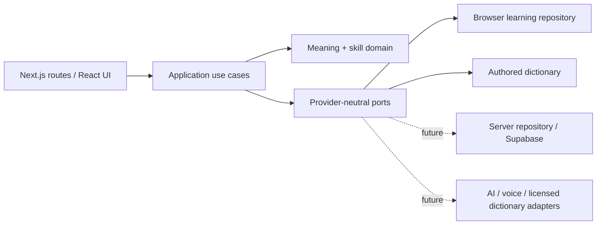

# Архитектура LEXIS

## Решение

Начать с модульного монолита на Next.js App Router, React и строгом TypeScript. Это даёт единый процесс разработки и позволяет проводить изменения через один учебный сценарий. Общая доменная модель важнее раннего разделения на сервисы: четырнадцать запланированных модулей станут отдельными функциональными областями внутри приложения.

Первый этап работает локально: браузерный репозиторий хранит версионированное состояние, авторский словарь отвечает без сети, чистые функции вычисляют историю и расписание. Подготовленная PostgreSQL-схема задаёт будущие ограничения хранения, но не означает подключения Supabase. Сервис авторизации, удалённые записи и синхронизация добавляются отдельным проверяемым этапом.



## Слои и границы

| Слой                 | Ответственность                                                                     | Ограничения                                                                     |
| -------------------- | ----------------------------------------------------------------------------------- | ------------------------------------------------------------------------------- |
| `src/app`            | Маршруты, layout, metadata, loading/error boundaries                                | Не вычисляет учебные оценки и не хранит ключи провайдеров в клиентском коде     |
| `src/components`     | Переиспользуемые элементы, экраны, доступные диалоги, навигация                     | Получает состояние и действия; визуальные компоненты не знают SQL               |
| `src/application`    | Контракты хранилища и интеграций; место для общих use cases при подключении сервера | Зависит от domain, а не от конкретного SDK                                      |
| `src/domain`         | Значения, навыки, валидация состояния, журнал наблюдений, расписание и пересчёт     | Чистый TypeScript без React, браузерных API и SDK                               |
| `src/infrastructure` | Browser storage, авторский словарь, будущие server adapters                         | Преобразует внешние данные в доменные типы и возвращает явные ошибки            |
| `supabase`           | Версионированные SQL-миграции и будущая локальная конфигурация                      | Удалённые миграции требуют отдельного согласованного подключения                |
| `tests`              | Доменные, SQL и браузерные проверки                                                 | Проверяет последствия для пользователя и ограничения, а не повторяет реализацию |

Проект пока не требует монорепозитория, пакета общей UI-библиотеки, очереди сообщений, векторной базы или отдельного AI-сервиса. При появлении независимых команд и нагрузок домен можно выделить в пакет; адаптеры позволяют сделать это без переписывания учебных правил.

В текущем локальном срезе `LearningProvider` в `src/components/learning-provider.tsx` координирует чистые доменные функции и конкретный browser repository. Объявленные в `src/application/ports.ts` порты внешних провайдеров ещё не имеют действующих подключений. Перед добавлением серверного репозитория координацию записи следует вынести в application use cases с единым контрактом ошибок и конкурентных изменений, чтобы React-компоненты не выбирали способ хранения.

## Структура репозитория

```text
lexis/
├── AGENTS.md
├── package.json                 # точные версии и команды проверок
├── package-lock.json
├── src/
│   ├── app/                     # Next.js entry points
│   ├── components/              # shell, screens, UI primitives
│   ├── application/             # use cases / ports
│   ├── domain/                  # types, validation, evidence, scheduling
│   └── infrastructure/
│       ├── dictionary/          # authored seed; licensed adapter later
│       └── storage/             # local repository; server repository later
├── supabase/migrations/
├── tests/
│   ├── unit/
│   ├── database/
│   └── e2e/
└── docs/
    ├── product.md
    ├── architecture.md
    ├── data-model.md
    ├── design-system.md
    ├── implementation-plan.md
    └── risks-and-dependencies.md
```

## Общая модель знаний

`lexeme` описывает языковую единицу, `sense` — конкретное значение. Сохранённое значение принадлежит пользователю. Наблюдение относится к одному значению и одному навыку и содержит источник, время и идентификатор события. Оценки навыков и очередь повторений — производные представления.

Чтение слова само по себе не доказывает понимание. Успешное распознавание не увеличивает оценку письма или речи. Неизмеренные навыки показываются как недостаток данных. Дополнительный модуль сообщает о своём наблюдении через общий контракт; он не записывает произвольный процент освоения.

Локальная первая версия использует самооценки и детерминированную эвристику расписания. Она не называется FSRS и не считается калиброванной моделью памяти. Часы передаются в доменные функции явно, чтобы тесты не зависели от текущего времени. Временные отметки хранятся в UTC; форматирование относится к UI.

Наблюдения сохраняются с уникальным идентификатором, чтобы повтор действия не дублировал результат. Оспаривание сохраняет след исправления и исключает выбранное событие из пересчёта. При изменении алгоритма нужна версия и возможность восстановить проекцию из исходных наблюдений. Для будущих AI-оценок дополнительно фиксируются provider/model, версия rubric, объяснение, уверенность и политика хранения исходного ответа.

Подробности таблиц и связей находятся в [data-model.md](data-model.md).

## Данные браузера и ошибки

Состояние содержит явную версию схемы. Прочитанные из storage данные проходят runtime-валидацию; TypeScript сам по себе не проверяет JSON. Неизвестная версия, некорректная дата или повреждённый массив не должны становиться валидной историей обучения.

Запись должна завершаться до сообщения об успехе. Storage denial, превышение квоты и повреждение данных получают понятное сообщение и безопасное восстановление. При сбросе данных нужно явное действие пользователя. Сохранение локально не равно регистрации, шифрованному архиву или резервной копии.

## Переход к серверному хранению

1. Подключить отдельный Supabase-проект и проверить актуальные Auth/SSR API. Секретные SDK используются только сервером.
2. Реализовать server repository через тот же контракт. Аутентификация подтверждается на сервере; переданный клиентом `user_id` не является доказательством владения.
3. Сделать запись наблюдения, обновление проекции и расписания одной транзакцией. Уникальный event ID обеспечивает retry safety.
4. Применить проверенные миграции сначала на тестовой среде. Проверить RLS реальными JWT двух пользователей и запрет подмены владельца; локальные PostgreSQL-тесты дополняют эти проверки.
5. Определить правила переноса локальной истории, дубликатов, конфликтов между устройствами и удаления. Не загружать локальные материалы автоматически.
6. Проверить весь сценарий в браузере, включая истёкшую сессию и потерю сети. Только после этого включать облачное сохранение в продукте.

Все пользовательские таблицы защищаются RLS. Публичный словарь может быть доступен на чтение, но не на изменение обычным пользователем. Производные оценки нельзя произвольно записывать из клиента. Внешние API вызываются через серверные адаптеры с ограничением размера запроса, timeout, контролем повторов и минимальным объёмом передаваемого контекста.

## Фронтенд и развёртывание

Tailwind CSS используется для типизированной по соглашениям токенизации и адаптивной вёрстки; семантика и доступность остаются ответственностью компонентов. Для простых появлений достаточно CSS transitions. Motion подключается только при появлении проверяемой пользы; Rive требует отдельного обоснования производительности и размера.

Vercel — рекомендуемая будущая среда Next.js. GitHub — хранилище исходников и CI. Подготовка проекта не означает, что репозиторий уже создан на GitHub или приложение опубликовано. До внешней публикации обязательны проверка окружения, Auth/RLS, наблюдаемость ошибок, политика данных и согласованная визуальная проверка на iPhone Safari.
