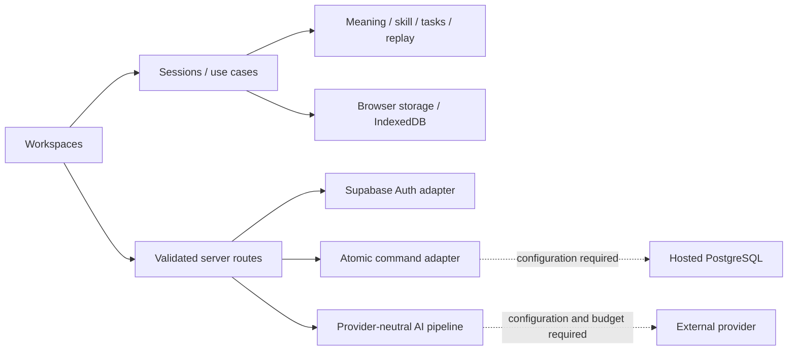

# Архитектура LEXIS

Актуальная инженерная реализация v2, 24 октября 2026. Модульный монолит Next.js App Router / React / strict TypeScript сохраняет существующую работу. Полный продукт подключается совместимыми сценариями S0–S9; прежний локальный vertical slice больше не является конечной целью. Приоритет источников — в [решениях](DECISIONS_AND_SOURCE_OF_TRUTH.md), реальная готовность — в [трассируемости](REQUIREMENTS_TRACEABILITY.md) и [PROGRESS](PROGRESS.md).

## Слои и зависимости

| Слой                  | Ответственность                                                                                       | Граница                                                                                       |
| --------------------- | ----------------------------------------------------------------------------------------------------- | --------------------------------------------------------------------------------------------- |
| `src/domain`          | Meaning/skill, task/evidence, FSRS replay, import models, writing/grammar, goals/metrics              | Чистый TypeScript; без React, Next и browser globals. FSRS использует закреплённую библиотеку |
| `src/application`     | LearningSession/TaskSession, общий clock, provider ports, validated server commands, AI orchestration | Получает storage/clock/IDs/provider через contracts; не дублирует правила в UI                |
| `src/infrastructure`  | Browser repositories, IndexedDB, bounded parsers, authored dictionary, Supabase SSR/RPC и AI adapters | Runtime validation, перевод ошибок, server-only секреты                                       |
| `src/components`      | Workspaces, общие panels, привязка к sessions, input/save/error/consent                               | Не SQL и не произвольная запись competence                                                    |
| `src/app`             | Маршруты, metadata, API boundaries, Auth callback                                                     | Проверяет origin/identity/input до trusted operations                                         |
| `supabase/migrations` | Versioned schema, ownership/RLS, atomic commands, quotas                                              | Локальные tests не подтверждают hosted JWT/storage                                            |

Нет микросервисов, graph/vector database, универсального plugin engine или тяжёлого editor SDK. Семантические связи — типизированные записи; поиск пока ограничен локальными источниками. Новые packages закреплены lockfile: `ts-fsrs@5.4.2`, `fflate@0.8.3`, `fast-xml-parser@5.11.2`, Supabase SSR/client и `server-only`; причины и точные FSRS API описаны отдельно.

## Локальная модель и orchestration

Существующая `LearningSession` сохраняет `LearningState.version=1`: self-review recognition, контекст, disputes и sample reading progress. Повреждённые bytes блокируют запись; успех публикуется только после commit. Save/import не создаёт evidence. Undo свежего save допускается только без связанной истории. Отдельный `TaskSession`/`TaskLearningProvider` хранит versioned definitions, attempts, assistance, final evaluations, observations, challenges и review events.

Семь lexical skills расширяют старые пять IDs совместимо; grammar имеет отдельный typed target. Детерминированные closed tasks допускают авторские альтернативы. Open semantic/speech/pronunciation assessment без capability остаётся uncertain/ungraded, а не incorrect. AI verdict пока advisory и не записывается клиентом как trusted evidence.

FSRS identity — target kind/ID + skill + prompt family. User Again/Hard/Good/Easy — отдельный rating, не автоматическое следствие AI/objective verdict. `ts-fsrs@5.4.2` FSRS-6 replay хранит версию/параметры; challenge исключает связанное влияние и воспроизводит все последующие события. Старый `heuristic-v1` не переименован: recognition-only bootstrap проходит preview/backup/confirmation. См. [FSRS/tasks](fsrs-and-tasks.md).

`LiveClock` — единый механизм времени: сроки legacy и task schedules, локальная полночь, focus/pageshow/visibility. UI использует общее `now`, а не конкурирующие интервалы. `use-review-overview` объединяет queues, исключая уже перенесённые legacy duplicates. UTC facts и local presentation/day policy различаются.

## Хранилища, ingest и контекст

Runtime-версия проверяется для каждого JSON store. localStorage serialized snapshot guard — best effort: он обнаруживает stale tab, но не является атомарной cross-tab compare-and-swap. Writing/media применяют собственные IndexedDB readwrite revision checks; конфликтующие draft branches сохраняются. Все эти stores принадлежат одной локальной идентичности. Auth сам по себе не изолирует их по аккаунтам.

EPUB/XLSX parsing ограничивает compressed/expanded size, entries, paths, ratio и фактическую inflation. XML не допускает DTD/entities; EPUB рендерится React text, без script/HTML/forms/remote requests; DRM не обходится. XLSX читает значения первой worksheet, не исполняет формулы/макросы/links. Vocabulary parsing идёт порциями, с progress/cancel до записи. Подробности — в [materials note](feature-notes/materials-ingest.md).

Reader хранит document/version/chapter/paragraph/character anchor, отдельно appearance prefs и bookmarks. Native selection остаётся текстовым Range. Dictionary lookup передаёт surface form и минимальный context; явный sense choice не превращает неизвестный импорт в первый seed sense. Full/Deep и Writing→Grammar используют bounded tab-local context/allowlisted return paths. Личные excerpts не помещаются в URL. Это ограниченный persistent context, не полная cross-device memory.

## Серверная основа и незакрытый cloud gate

`src/infrastructure/supabase` содержит текущие SSR APIs, request-scoped clients, no-store session handling, trusted `getUser`, origin/redirect guards и server-only RPC client. `/account`, `/auth/callback`, `/api/account`, `/api/learning/command` имеют явное unconfigured состояние. Клиент передаёт небольшие команды с idempotency/revision, а не полный профиль или доверенный owner/score/provider.

Миграция `20261022205958_archive_and_atomic_commands.sql` разделяет archive и purge, ограничивает ownership составными FK, предоставляет служебные атомарные команды self-review/dispute/archive/explicit purge/writing revision/legacy ID mapping. Новый local legacy ID не обязан быть UUID: deterministic mapping сохраняет происхождение и повторяемость. SQL использует SECURITY INVOKER с ограниченными grants. AI reservation migration добавляет отдельные квоты/журнал, без выдачи клиенту права произвольной trusted оценки.

**Не реализовано целиком и не live-проверено:** hosted Supabase Auth/JWT/Data API/storage, полный remote repository/projector, transactional task/FSRS cloud writes, local→account migration UI, два устройства, account-scoped cache/offline commands и complete backup/account purge. Локальные PGlite auth stubs проверяют настоящий SQL/RLS в своей среде, не эти hosted gates. Пользователь не должен получать обещание cloud sync по одному успешному login.

## Внешние capabilities и приватность

Dictionary lookup, AI evaluation/tutoring, ASR/TTS/live/scorer имеют разные capability границы. Authorial seed — восемь слов/десять senses, без live source/audio. AI configuration не имеет вымышленной default model/цены: explicit enable, real model ID, server key, per-user/server budgets и trusted quota store обязательны. Pipeline ограничивает consent/context, input/schema/references, timeout/cancel/late results и idempotency. Документ/книга — недоверенные данные, а не инструкции к произвольным SQL/tools. No configuration → honest unavailable, не canned conversation.

Voice preview не захватывает звук. Listening отдельно воспроизводит настоящий sample/private files, фиксирует transcript assistance и короткий opt-in shadow recording; он не доказывает live transport/ASR/TTS/pronunciation. Микрофон разрешается route-specific только там, где есть capture. Имена/значения секретов не выдаются в клиент, logs или telemetry; raw books/drafts/audio не уходят во внешнюю аналитику.

Полная purge-coordination и opt-in offline workspace развиваются отдельным срезом. Service worker должен кэшировать только public shell/static assets; private API/Auth/materials не становятся общим cache. Реальная offline/update/account-switch проверка и physical iPhone остаются отдельными gates; localStorage сам по себе не означает PWA.

## Toolchain, CI и выпуск

Точные версии — в `package.json`/lockfile. ESLint 9.39.5 совместим с текущим React plugin, но EOL; обновление проверяется без force/peer suppression. Next `useTypeScriptCli:false` выбирает compiler API, strict/typecheck не отключены. CI: install → format → lint → strict tsc → unit/database → production build → Chromium/WebKit journeys и failure traces.

Semantic CSS/Tailwind tokens и feature CSS modules сохраняют тёплые читаемые материалы; CSS transform/opacity достаточно для текущей анимации. Дополнительные Motion/Rive/WebGL не вводятся без необходимости и замера.

Vercel/HTTPS/deployment, production security/CSP, provider budget/retention, backup/restore drill и operation/rollback runbook не подтверждаются сборкой или GitHub push. Все live/device/rights gates перечислены в [рисках](risks-and-dependencies.md). Новые screenshots и final test outcomes относятся к конкретной собранной версии; старый зелёный CI не наследуется новым кодом.

## Versioned assessment withdrawal

`application/assessment-withdrawals.ts` is an explicit content-policy registry, separate from pure domain rules. Exact task/version/rubric matching produces stable audit metadata and schedule exclusions; original task and attempt bytes are preserved. `TaskLearningProvider` exposes the corrected projection before persistence and blocks scheduling decisions if correction cannot be committed. Active competence, Observatory and goal/recommendation inputs use the corrected state; raw observations remain inspectable audit. See [assessment withdrawal behavior and checks](feature-notes/assessment-withdrawals.md).

Additional private passages live in an additive validated local store, with idempotent source identity and explicit backup/merge/removal. Saving another passage for an existing sense does not rewrite learning v1 or create evidence. See [saved contexts](feature-notes/saved-contexts.md). These local stores do not imply cloud transactions or account isolation.
