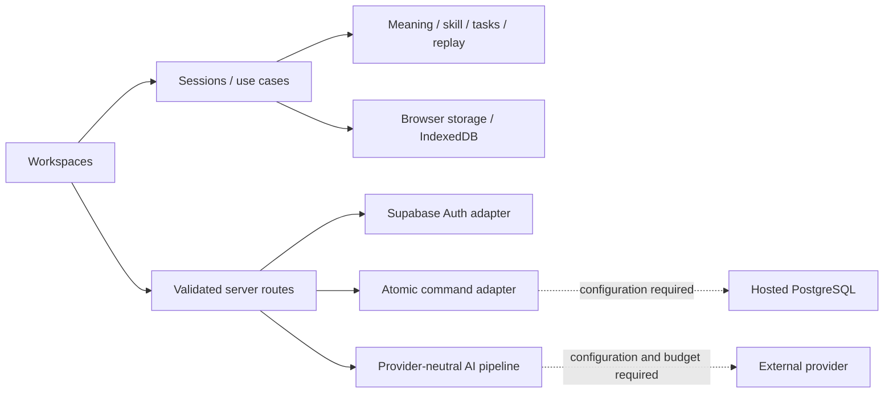

# Архитектура LEXIS

Актуальная инженерная реализация v2, 26 октября 2026. Модульный монолит Next.js App Router / React / strict TypeScript сохраняет существующую работу. Полный продукт подключается совместимыми сценариями S0–S9; прежний локальный vertical slice больше не является конечной целью. Приоритет источников — в [решениях](DECISIONS_AND_SOURCE_OF_TRUTH.md), реальная готовность — в [трассируемости](REQUIREMENTS_TRACEABILITY.md) и [PROGRESS](PROGRESS.md).

## Слои и зависимости

| Слой                  | Ответственность                                                                                       | Граница                                                                                       |
| --------------------- | ----------------------------------------------------------------------------------------------------- | --------------------------------------------------------------------------------------------- |
| `src/domain`          | Meaning/skill, task/evidence, FSRS replay, import models, writing/grammar, goals/metrics              | Чистый TypeScript; без React, Next и browser globals. FSRS использует закреплённую библиотеку |
| `src/application`     | LearningSession/TaskSession, общий clock, provider ports, validated server commands, AI orchestration | Получает storage/clock/IDs/provider через contracts; не дублирует правила в UI                |
| `src/infrastructure`  | Browser repositories, IndexedDB, bounded parsers, authored dictionary, Supabase SSR/RPC и AI adapters | Runtime validation, перевод ошибок, server-only секреты                                       |
| `src/components`      | Workspaces, общие panels, привязка к sessions, input/save/error/consent                               | Не SQL и не произвольная запись competence                                                    |
| `src/app`             | Маршруты, metadata, API boundaries, Auth callback                                                     | Проверяет origin/identity/input до trusted operations                                         |
| `supabase/migrations` | Versioned schema, ownership/RLS, atomic commands, quotas                                              | Локальные tests не подтверждают hosted JWT/storage                                            |

Нет микросервисов, graph/vector database, универсального plugin engine или тяжёлого editor SDK. Семантические связи — типизированные записи; поиск пока ограничен локальными источниками. Новые packages закреплены lockfile: `ts-fsrs@5.4.2`, `fflate@0.8.3`, `fast-xml-parser@5.11.2`, Supabase SSR/client и `server-only`; причины и точные FSRS API описаны отдельно.

## Локальная модель и orchestration

Существующая `LearningSession` сохраняет `LearningState.version=1`: self-review recognition, контекст, disputes и sample reading progress. Повреждённые bytes блокируют запись; успех публикуется только после commit. Save/import не создаёт evidence. Undo свежего save допускается только без связанной истории. Отдельный `TaskSession`/`TaskLearningProvider` хранит versioned definitions, attempts, assistance, final evaluations, observations, challenges и review events.

Семь lexical skills расширяют старые пять IDs совместимо; grammar имеет отдельный typed target. Детерминированные closed tasks допускают авторские альтернативы. Open semantic/speech/pronunciation assessment без capability остаётся uncertain/ungraded, а не incorrect. AI verdict пока advisory и не записывается клиентом как trusted evidence.

FSRS identity — target kind/ID + skill + prompt family. User Again/Hard/Good/Easy — отдельный rating, не автоматическое следствие AI/objective verdict. `ts-fsrs@5.4.2` FSRS-6 replay хранит версию/параметры; challenge исключает связанное влияние и воспроизводит все последующие события. Старый `heuristic-v1` не переименован: recognition-only bootstrap проходит preview/backup/confirmation. См. [FSRS/tasks](fsrs-and-tasks.md).

`LiveClock` — единый механизм времени: сроки legacy и task schedules, локальная полночь, focus/pageshow/visibility. UI использует общее `now`, а не конкурирующие интервалы. `use-review-overview` объединяет queues, исключая уже перенесённые legacy duplicates. UTC facts и local presentation/day policy различаются.

## Хранилища, ingest и контекст

Runtime-версия проверяется для каждого JSON store. localStorage serialized snapshot guard — best effort: он обнаруживает stale tab, но не является атомарной cross-tab compare-and-swap. Writing/media применяют собственные IndexedDB readwrite revision checks; конфликтующие draft branches сохраняются. Все эти stores принадлежат одной локальной идентичности. Auth сам по себе не изолирует их по аккаунтам.

EPUB/XLSX parsing ограничивает compressed/expanded size, entries, paths, ratio и фактическую inflation. XML не допускает DTD/entities; EPUB рендерится React text, без script/HTML/forms/remote requests; DRM не обходится. XLSX читает значения первой worksheet, не исполняет формулы/макросы/links. Vocabulary parsing идёт порциями, с progress/cancel до записи. Подробности — в [materials note](feature-notes/materials-ingest.md).

Reader хранит document/version/chapter/paragraph/character anchor, отдельно appearance prefs и bookmarks. Native selection остаётся текстовым Range. Dictionary lookup передаёт surface form и минимальный context; явный sense choice не превращает неизвестный импорт в первый seed sense. Full/Deep и Writing→Grammar используют bounded tab-local context/allowlisted return paths. Личные excerpts не помещаются в URL. Это ограниченный persistent context, не полная cross-device memory.

## Пользовательский лексический каталог

`src/domain/lexical-catalog.ts` хранит определения отдельно от намерений и учебных наблюдений. `lexis.lexical-catalog.v1` содержит внутренние `user-lexeme-*`/`user-sense-*` IDs, POS, явные формы, оригинальные значения и provenance `user-authored`. Создание и добавление значения к явно выбранной лексеме не записывают evidence. Исходное содержание не редактируется незаметно: другой смысл получает отдельный ID, прежние task definitions и история остаются неизменными. Восстановленный пользовательский файл не может занять namespace редакционных значений.

`LexicalCatalogProvider` объединяет редакционные и пользовательские записи через общий `DictionaryLookupPort`. Источники и одинаково написанные POS не сливаются; неоднозначность требует выбора. Quick View, Full Entry, Library, Command, Review, Core и Observatory разрешают один и тот же sense ID. Semantic Network показывает отсутствие подтверждённых связей для новой записи, а не выдумывает их. Deep Dive для пользовательской записи не обещает редакционных нюансов или аудио.

Memoized exact index обслуживает проверки токенов Reader и кандидатов Inbox, не сканируя все определения для каждого слова/строки. Текстовый поиск остаётся bounded local lookup; списки Dictionary/каталога выдаются порциями. Выбранный sense при возврате в Reader проверяется среди подходящих исходной форме записей, поэтому совпадение написания с редакционным словом не сбрасывает явный выбор.

`catalog-tasks.ts` создаёт common tasks с `source.kind=user`: закрытый ответ проверяет воспроизведение пользовательского ключа, не подтверждает точность определения. Evidence относится только к выполненному skill; FSRS использует обычную target/skill/prompt-family identity. Открытое предложение без semantic evaluator остаётся ungraded. Smart Inbox связывает строку с определением отдельно от явного Save; отказ второй записи сообщает о частичном результате и допускает повтор.

Каталог ограничен 4 000 000 serialized UTF-16 code units, 2 000 entries, 10 000 senses и 30 senses на entry. Runtime validation, stale-byte guard и purge barrier сохраняют прежние bytes при ошибке. Additive restore показывает preview, сохраняет IDs и блокирует конфликт содержания одного ID. Это одно browser-local хранилище, не облачная транзакция или account isolation. При повреждении доступен original export/reload; отдельный reset только этого store ещё не реализован. Подробности и тестовые границы — в [user meanings](feature-notes/user-meanings.md).

## Общий локальный backup и восстановление — 26 октября

Новый локальный протокол связывает stores через `src/application/profile-sections.ts`, `src/application/profile-recovery.ts` и `src/infrastructure/profile/`. Он использует существующие domain merge/replay rules, а не вторую модель прогресса. `/settings/backup` предоставляет выбор разделов, проверку файла, preview конфликтов и явное подтверждение additive merge. Уровень фактической проверки нового среза и точный SHA фиксируются в [PROGRESS](PROGRESS.md); его реализация не закрывает hosted backup или cloud sync.

Файл `.lexis` — versioned framed container, без ZIP/decompression: magic `LEXISBK1`, big-endian длина JSON manifest, manifest и последовательные JSON/media parts. Manifest фиксирует scope `local`, ID/время, section IDs, размеры и SHA-256 каждого part. Integrity hash обнаруживает повреждение; он не шифрует файл и не удостоверяет автора. Содержимое приватно, но скачанный файл не зашифрован: пользователь сам выбирает безопасное место хранения. Чтение и hashing идут по ограниченным parts, не через `arrayBuffer()` всего файла; progress/cancel не меняют исходные данные. Пределы — 512 MiB на файл, 1 MiB manifest, 64 parts, 128 MiB JSON part, 25 MiB media asset; в текущей медиатеке не более 10 assets. Превышение отклоняется, а не обрезается.

Inventory при открытии `/settings/backup` валидирует metadata/session rows и показывает counts без Blob decoding, чтения аудиобайтов и SHA. Full media snapshot/hash выполняется только по явному export/restore. Native IDB cursor может скопировать один ограниченный ArrayBuffer record; это не обещание index-only query или измеренной максимальной ёмкости iPhone. FileReader поддерживает отмену явного чтения и cleanup; pagehide — best effort при browser teardown, не универсальная гарантия отсутствия WebKit errors. Эта граница и регрессии уточнены 28 октября после воспроизведения фонового чтения при reload.

Allowlist включает learning/tasks/materials/catalog/sense-contexts/goals/preferences/reader-preferences/practice-session/Tutor-local, Writing IndexedDB и media metadata/sessions/binaries. JSON-body оборачивается в `{raw: string | null}`: отсутствующий ключ отличается от повреждённой строки, а lone UTF-16 surrogates не заменяются при UTF-8 кодировании Blob. Read-only export не создаёт defaults и не переписывает повреждённый источник. Неподдерживаемые поля или unreadable JSON остаются `opaque` recovery attachment, без обещания безопасного restore. Auth/SDK cookies и keys, account-prefixed Tutor, service-worker cache, purge markers, ephemeral context visits и server caches в этот allowlist не входят. EPUB сохраняется в уже извлечённой безопасной текстовой модели, не как оригинальный архив.

Preview проверяет runtime schemas, stable identities и зависимости. Неизвестный external sense остаётся unavailable с прежней историей. Совпавший ID с иным immutable содержимым блокирует выбранный раздел; settings остаются текущими до отдельного выбора. Writing merge сохраняет исходные revisions и конфликтующие branches; media metadata/binary/session collisions не перезаписываются. Ранее разрешённый pending Tutor request не отправляется заново: pending message становится cancelled, разрешение на внешний context не восстанавливается.

Общая операция не атомарна между localStorage и двумя IndexedDB. Сначала подготовка останавливает feature writes/requests/playback/capture и отклоняет restore при несохранённом Writing input, сохраняя текст. Затем все payloads сохраняются в отдельном IDB staging journal `lexis.profile-backup.v1`, публикуется marker, устанавливается новый profile epoch и проверяются исходные fingerprints до первой live-записи. Каждый шаг использует expected state, разрешённый operation ID и проверку прочитанного результата; receipt записывается только после readback. Повтор видит exact after-state и не создаёт второе событие. Если запись прошла, а receipt потерян, resume подтверждает уже применённый шаг по fingerprint.

Ошибка/отмена после начала оставляет видимый partial marker и блокирует обычные writers до resume либо явного принятия частичного результата. Это не rollback и не сообщение о полном успехе. Завершение проверяет все target fingerprints; отдельное открытие профиля снимает finished marker и перезагружает приложение. Epoch не позволяет старым вкладкам продолжить запись прежних snapshots после снятия marker. Межвкладочное уведомление кооперативное: замороженную ОС вкладку нельзя считать синхронно остановленной. localStorage CAS остаётся best effort; это не cloud transaction и не гарантия конкурентного доступа разных устройств. Eviction/потеря staged payload требует явного recovery сообщения, а не hidden reset.

## Серверная основа и незакрытый cloud gate

`src/infrastructure/supabase` содержит текущие SSR APIs, request-scoped clients, no-store session handling, trusted `getUser`, origin/redirect guards и server-only RPC client. `/account`, `/auth/callback`, `/api/account`, `/api/learning/command` имеют явное unconfigured состояние. Клиент передаёт небольшие команды с idempotency/revision, а не полный профиль или доверенный owner/score/provider.

Миграция `20261022205958_archive_and_atomic_commands.sql` разделяет archive и purge, ограничивает ownership составными FK, предоставляет служебные атомарные команды self-review/dispute/archive/explicit purge/writing revision/legacy ID mapping. Новый local legacy ID не обязан быть UUID: deterministic mapping сохраняет происхождение и повторяемость. SQL использует SECURITY INVOKER с ограниченными grants. AI reservation migration добавляет отдельные квоты/журнал, без выдачи клиенту права произвольной trusted оценки.

**Не реализовано целиком и не live-проверено:** hosted Supabase Auth/JWT/Data API/storage, полный remote repository/projector, transactional task/FSRS cloud writes, local→account migration UI, два устройства, account-scoped cache/offline commands и complete backup/account purge. Локальные PGlite auth stubs проверяют настоящий SQL/RLS в своей среде, не эти hosted gates. Пользователь не должен получать обещание cloud sync по одному успешному login.

## Внешние capabilities и приватность

Dictionary lookup, AI evaluation/tutoring, ASR/TTS/live/scorer имеют разные capability границы. Authorial seed — восемь слов/десять senses, без live source/audio. AI configuration не имеет вымышленной default model/цены: explicit enable, real model ID, server key, per-user/server budgets и trusted quota store обязательны. Pipeline ограничивает consent/context, input/schema/references, timeout/cancel/late results и idempotency. Документ/книга — недоверенные данные, а не инструкции к произвольным SQL/tools. No configuration → honest unavailable, не canned conversation.

Voice preview не захватывает звук. Listening отдельно воспроизводит настоящий sample/private files, фиксирует transcript assistance и короткий opt-in shadow recording; он не доказывает live transport/ASR/TTS/pronunciation. Микрофон разрешается route-specific только там, где есть capture. Имена/значения секретов не выдаются в клиент, logs или telemetry; raw books/drafts/audio не уходят во внешнюю аналитику.

Локальные purge-coordination и opt-in offline workspace реализованы и проверены browser journeys, включая остановку поздних writes, удаление собственных stores/cache/worker и чтение локального материала с выключенной сетью. Service worker кэширует public shell/static assets; private API/Auth/pages не становятся общим cache, а материал остаётся в browser storage. Ошибка удаления сохраняет блокирующий marker и сообщает о частичном результате. Это local single-device scope: полный update/version-compatibility, account-switch isolation, hosted deletion и physical iPhone остаются отдельными gates. Результаты конкретных source/checks — в [PROGRESS](PROGRESS.md); localStorage сам по себе не означает PWA.

## Toolchain, CI и выпуск

Точные версии — в `package.json`/lockfile. ESLint 9.39.5 совместим с текущим React plugin, но EOL; обновление проверяется без force/peer suppression. Next `useTypeScriptCli:false` выбирает compiler API, strict/typecheck не отключены. CI: install → format → lint → strict tsc → unit/database → production build → Chromium/WebKit journeys и failure traces.

Semantic CSS/Tailwind tokens и feature CSS modules сохраняют тёплые читаемые материалы; CSS transform/opacity достаточно для текущей анимации. Дополнительные Motion/Rive/WebGL не вводятся без необходимости и замера.

Vercel/HTTPS/deployment, production security/CSP, provider budget/retention, backup/restore drill и operation/rollback runbook не подтверждаются сборкой или GitHub push. Все live/device/rights gates перечислены в [рисках](risks-and-dependencies.md). Новые screenshots и final test outcomes относятся к конкретной собранной версии; старый зелёный CI не наследуется новым кодом.

## Versioned assessment withdrawal

`application/assessment-withdrawals.ts` is an explicit content-policy registry, separate from pure domain rules. Exact task/version/rubric matching produces stable audit metadata and schedule exclusions; original task and attempt bytes are preserved. `TaskLearningProvider` exposes the corrected projection before persistence and blocks scheduling decisions if correction cannot be committed. Active competence, Observatory and goal/recommendation inputs use the corrected state; raw observations remain inspectable audit. See [assessment withdrawal behavior and checks](feature-notes/assessment-withdrawals.md).

Additional private passages live in an additive validated local store, with idempotent source identity and explicit backup/merge/removal. Saving another passage for an existing sense does not rewrite learning v1 or create evidence. See [saved contexts](feature-notes/saved-contexts.md). These local stores do not imply cloud transactions or account isolation.
