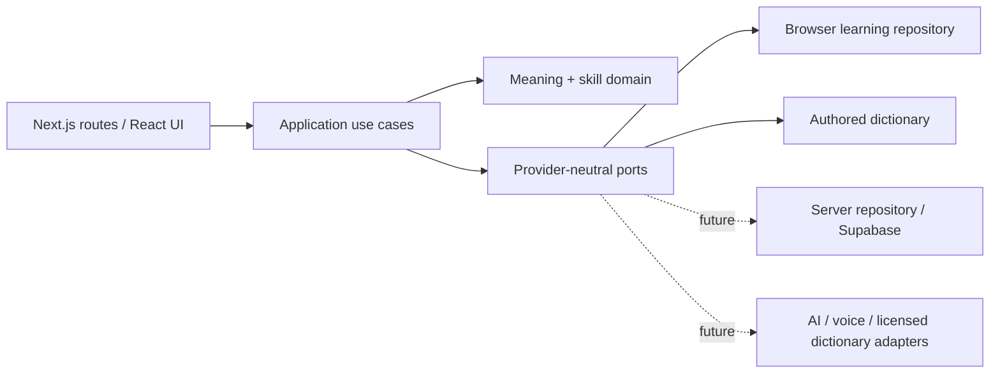

# Архитектура LEXIS

## Решение

Начать с модульного монолита на Next.js App Router, React и строгом TypeScript. Это даёт единый процесс разработки и позволяет проводить изменения через один учебный сценарий. Общая доменная модель важнее раннего разделения на сервисы: четырнадцать запланированных модулей станут отдельными функциональными областями внутри приложения.

Архитектура продолжает полученный 22 октября [handoff](source/TECH_ARCHITECTURE.md). Продуктовые решения и приоритет источников зафиксированы в [DECISIONS_AND_SOURCE_OF_TRUTH.md](DECISIONS_AND_SOURCE_OF_TRUTH.md); полная структура handoff — blueprint, который адаптируется к уже существующему коду без разрушительной перестройки.

Первый этап работает локально: браузерный репозиторий хранит версионированное состояние, авторский словарь отвечает без сети, чистые функции вычисляют историю и расписание. Подготовленная PostgreSQL-схема задаёт будущие ограничения хранения, но не означает подключения Supabase. Сервис авторизации, удалённые записи и синхронизация добавляются отдельным проверяемым этапом.



## Слои и границы

| Слой                 | Ответственность                                                                     | Ограничения                                                                     |
| -------------------- | ----------------------------------------------------------------------------------- | ------------------------------------------------------------------------------- |
| `src/app`            | Маршруты, layout, metadata, loading/error boundaries                                | Не вычисляет учебные оценки и не хранит ключи провайдеров в клиентском коде     |
| `src/components`     | Переиспользуемые элементы, экраны, доступные диалоги, навигация                     | Получает состояние и действия; визуальные компоненты не знают SQL               |
| `src/application`    | Контракты хранилища и интеграций; место для общих use cases при подключении сервера | Зависит от domain, а не от конкретного SDK                                      |
| `src/domain`         | Значения, навыки, валидация состояния, журнал наблюдений, расписание и пересчёт     | Чистый TypeScript без React, браузерных API и SDK                               |
| `src/infrastructure` | Browser storage, авторский словарь, будущие server adapters                         | Преобразует внешние данные в доменные типы и возвращает явные ошибки            |
| `supabase`           | Версионированные SQL-миграции и будущая локальная конфигурация                      | Удалённые миграции требуют отдельного согласованного подключения                |
| `tests`              | Доменные, SQL и браузерные проверки                                                 | Проверяет последствия для пользователя и ограничения, а не повторяет реализацию |

Проект пока не требует монорепозитория, пакета общей UI-библиотеки, очереди сообщений, векторной базы или отдельного AI-сервиса. При появлении независимых команд и нагрузок домен можно выделить в пакет; адаптеры позволяют сделать это без переписывания учебных правил.

Локальная координация реализована в `src/application/learning-session.ts`: `LearningSession` зависит от snapshot-storage port, получает clock/event IDs через параметры и публикует новое состояние только после успешного commit. `LearningProvider` связывает application-команды с React, отображает ошибки и ограничивает undo сохранениями текущего посещения. Регрессионные unit-тесты session/storage пройдены 22 октября. Порты внешних AI/voice-провайдеров ещё не имеют действующих подключений.

Локальная session сохраняет формат `LearningState.version = 1`, чтение старых данных, блокировку записи при повреждении и best-effort stale-snapshot guard. Undo разрешён для свежего сохранения, пока оно не связано с evidence; существующая история не удаляется. `canUndoSave` не разрешает отменять прежнее idempotent-сохранение. Font/spacing preferences Reader находятся в отдельном ключе `lexis.reader.preferences.v1` и не изменяют структуру evidence. Это разделение не превращает localStorage в транзакционную многопользовательскую БД.

## Структура репозитория

```text
lexis/
├── AGENTS.md
├── package.json                 # точные версии и команды проверок
├── package-lock.json
├── src/
│   ├── app/                     # Next.js entry points
│   ├── components/              # shell, screens, UI primitives
│   ├── application/             # use cases / ports
│   ├── domain/                  # types, validation, evidence, scheduling
│   └── infrastructure/
│       ├── dictionary/          # authored seed; licensed adapter later
│       └── storage/             # local repository; server repository later
├── supabase/migrations/
├── tests/
│   ├── unit/
│   ├── database/
│   └── e2e/
└── docs/
    ├── product.md
    ├── architecture.md
    ├── data-model.md
    ├── design-system.md
    ├── implementation-plan.md
    └── risks-and-dependencies.md
```

## Общая модель знаний

`lexeme` описывает языковую единицу, `sense` — конкретное значение. Сохранённое значение принадлежит пользователю. Наблюдение относится к одному значению и одному навыку и содержит источник, время и идентификатор события. Оценки навыков и очередь повторений — производные представления.

Чтение слова само по себе не доказывает понимание. Успешное распознавание не увеличивает оценку письма или речи. Неизмеренные навыки показываются как недостаток данных. Дополнительный модуль сообщает о своём наблюдении через общий контракт; он не записывает произвольный процент освоения.

Локальная первая версия использует самооценки и детерминированную эвристику расписания `heuristic-v1`. Она не называется FSRS и не считается калиброванной моделью памяти; FSRS с вариативной практикой остаётся утверждённым направлением. Выбор implementation/version и mapping review items требует отдельной проверки. Внутренний score поддерживает расчёт, но UI не должен представлять его как точный процент владения. Часы передаются в доменные функции явно, чтобы тесты не зависели от текущего времени. Временные отметки хранятся в UTC; форматирование относится к UI.

Наблюдения сохраняются с уникальным идентификатором, чтобы повтор действия не дублировал результат. Оспаривание сохраняет след исправления и исключает выбранное событие из пересчёта. При изменении алгоритма нужна версия и возможность восстановить проекцию из исходных наблюдений. Для будущих AI-оценок дополнительно фиксируются provider/model, версия rubric, объяснение, уверенность и политика хранения исходного ответа.

Подробности таблиц и связей находятся в [data-model.md](data-model.md).

Дальнейшие listening/pronunciation measurements и GrammarConcept вводятся отдельными типами/миграциями после определения критериев. Пять текущих skill IDs не являются основанием выводить аудирование из чтения транскрипта или грамматику из факта знакомства с предложением.

## Данные браузера и ошибки

Состояние содержит явную версию схемы. Прочитанные из storage данные проходят runtime-валидацию; TypeScript сам по себе не проверяет JSON. Неизвестная версия, некорректная дата или повреждённый массив не должны становиться валидной историей обучения.

Все восемь записей авторского dictionary имеют типизированную provenance: источник, версия и статус содержимого. Будущий адаптер должен отличать редакционную запись, лицензированный источник и AI-предложение; наличие IPA не подтверждает доступность audio. Исходные референсы и `docs/source/` не включаются в runtime UI и не используются как словарный контент.

Запись должна завершаться до сообщения об успехе. Storage denial, превышение квоты и повреждение данных получают понятное сообщение и безопасное восстановление. При сбросе данных нужно явное действие пользователя. Сохранение локально не равно регистрации, шифрованному архиву или резервной копии.

## Переход к серверному хранению

1. Подключить отдельный Supabase-проект и проверить актуальные Auth/SSR API. Секретные SDK используются только сервером.
2. Вынести асинхронные команды сохранения значения, записи наблюдения и оспаривания в application use cases. Browser snapshot `LearningState` — локальный формат, а не payload для перезаписи всей серверной истории. Сервер принимает небольшие команды с event ID, а чтение возвращает страницы коллекции и производные представления. Аутентификация подтверждается на сервере; переданный клиентом `user_id` не является доказательством владения.
3. Сделать запись наблюдения, обновление проекции и расписания одной транзакцией. Уникальный event ID обеспечивает retry safety.
4. Применить проверенные миграции сначала на тестовой среде. Проверить RLS реальными JWT двух пользователей и запрет подмены владельца; локальные PostgreSQL-тесты дополняют эти проверки.
5. Определить правила переноса локальной истории, дубликатов, конфликтов между устройствами и удаления. Не загружать локальные материалы автоматически.
6. Проверить весь сценарий в браузере, включая истёкшую сессию и потерю сети. Только после этого включать облачное сохранение в продукте.

Все пользовательские таблицы защищаются RLS. Публичный словарь может быть доступен на чтение, но не на изменение обычным пользователем. Производные оценки нельзя произвольно записывать из клиента. Внешние API вызываются через серверные адаптеры с ограничением размера запроса, timeout, контролем повторов и минимальным объёмом передаваемого контекста.

## Фронтенд и развёртывание

Tailwind CSS используется как основа CSS. `src/app/globals.css` подключает `src/styles/tokens.css`, `layout.css`, `materials.css` и `orb.css`: семантические цвета/type/space, компоновка, состояния поверхностей и лёгкая membrane-анимация разделены. Семантика и доступность остаются ответственностью компонентов. Для простых появлений достаточно CSS transitions. Motion подключается только при появлении проверяемой пользы; Rive требует отдельного обоснования производительности и размера.

Toolchain на 22 октября: TypeScript 6.0.3, ESLint 9.39.5, eslint-config-next 16.4.2. TypeScript 7 не поддерживался выбранным typescript-eslint. ESLint 9 совместим с peer range React-плагина 7.37.5, но помечен npm deprecated/EOL; переход на поддерживаемую совместимую цепочку остаётся dev-tooling задачей. В Next.js `experimental.useTypeScriptCli: false` выбирает compiler API: default CLI-интеграция TS6 возвращала пустой JSON, хотя отдельный tsc работал. Compiler API прошёл strict build; `ignoreBuildErrors` не включён. Эти настройки — техническая совместимость, а не изменение продуктового контракта.

В handoff Mobile PWA — утверждённое направление, но manifest/icons, app-shell cache, offline policy и iOS installation flow пока не реализованы. Browser-local storage не гарантирует работу приложения без сети или неограниченную сохранность данных. Эти возможности требуют отдельного среза с storage eviction и privacy-проверками.

Vercel — рекомендуемая будущая среда Next.js. GitHub — хранилище исходников и CI. Подготовка проекта не означает, что репозиторий уже создан на GitHub или приложение опубликовано. До внешней публикации обязательны проверка окружения, Auth/RLS, наблюдаемость ошибок, политика данных и согласованная визуальная проверка на iPhone Safari.
