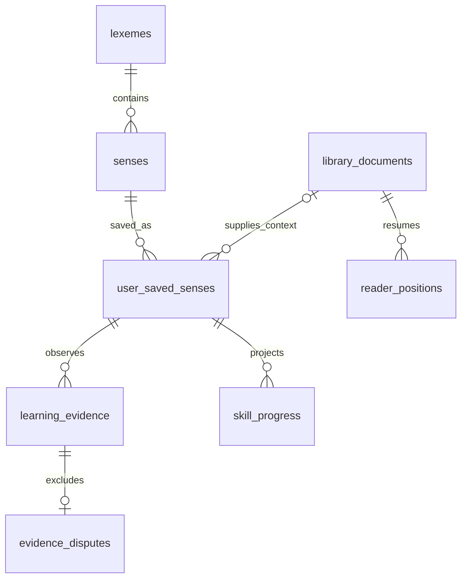

# Модель знаний и PostgreSQL

LEXIS различает лексему, конкретное значение и владение значением в конкретном навыке. Главный ключ учебного прогресса: `(user_id, sense_id, skill)`. Сохранение значения не создаёт оценку знания. Отсутствие наблюдений означает «нет данных», а не нулевое владение.

| Таблица             | Назначение и ограничения                                                                                                      |
| ------------------- | ----------------------------------------------------------------------------------------------------------------------------- |
| `lexemes`           | Английская лексема, часть речи, IPA, источник и версия источника. Омонимы и разные источники могут иметь разные записи.       |
| `senses`            | Стабильный ID значения, определение, русский перевод, авторский пример и коллокации; ссылка на лексему.                       |
| `library_documents` | Только принадлежащие пользователю метаданные документа; исходный текст книги не загружается автоматически.                    |
| `reader_positions`  | Позиция чтения в символах; составной внешний ключ связывает документ с тем же пользователем.                                  |
| `user_saved_senses` | Уникальная пара пользователь–значение, дата сохранения, короткий контекст до 1000 символов и необязательный источник.         |
| `learning_evidence` | Наблюдение по одному значению и одному навыку; источник, версия источника, рубрика, объяснение, время и ключ идемпотентности. |
| `evidence_disputes` | Неизменяемое исключение принадлежащего пользователю наблюдения из пересчёта. Оригинал сохраняется.                            |
| `skill_progress`    | Восстанавливаемая проекция по навыку: оценка, число попыток, срок повторения, версия алгоритма. Запись только сервером.       |

Навыки: `recognition` (узнавание), `context` (понимание в контексте), `recall` (активное воспроизведение), `writing` и `speaking`. Простое чтение или самооценка карточки не являются доказательством письма или устной речи.

## Наблюдения, расписание и оспаривание

В первом браузерном сценарии самооценка сохраняется как `self-review`, исключительно для `recognition`. Это субъективная отметка, не AI-проверка. Повторный запрос с тем же ключом не добавляет ещё одно наблюдение. Порядок воспроизведения должен быть детерминирован: время наблюдения плюс ID при равенстве времени.

Серверная модель предусматривает источники `ai-verification`, `reader`, `writing`, `voice`, `tutor`, но браузер не вправе создавать такие записи или записывать проверенную оценку/уверенность. AI-адаптер впоследствии должен сохранять поставщика, модель, версию рубрики и объяснение. Сырые ответы, аудио и промпты по умолчанию не хранятся.

`evidence_disputes` не изменяет исходный вывод. Для текущего scope оспаривание сразу исключает наблюдение. История апелляций и подтверждение новой оценкой добавятся отдельными событиями. Проекция должна полностью пересчитываться после исключения, включая интервалы; сохранённое значение после исключения всех его наблюдений снова требует первичного повторения.

Браузерный репозиторий уже вычисляет проекции на чтении. SQL-таблица проекций пока представляет контракт будущего сервера. Перед подключением удалённого репозитория нужен атомарный use case: проверка пользователя и владения → идемпотентное наблюдение/исключение → пересчёт проекции → commit. Нельзя отдельно принять апелляцию и продолжать отдавать старую кэшированную оценку. Реализация конкурентных транзакций и фонового пересчёта входит в production gate, а не имитируется текущим UI.

## Доступ и хранение

RLS включён на всех восьми таблицах в `public`; права выданы явно после отзыва возможных широких project defaults. Каталог доступен только на чтение для `authenticated`. Личные таблицы проверяют `auth.uid() = user_id`; `UPDATE` имеет и `USING`, и `WITH CHECK`. Составные внешние ключи запрещают привязать к своей записи чужой документ или чужое наблюдение. Для браузера evidence/disputes доступны только на чтение и добавление; оценки — только на чтение. `SECURITY DEFINER`, views и публичных привилегированных функций нет.

Индексы покрывают владельца, воспроизведение наблюдений и очередь повторений. На первом этапе не нужны embeddings, графовая СУБД, партиционирование или отдельный сервис на каждый модуль.

Удаление аккаунта каскадно удаляет личные записи. Удаление сохранённого значения каскадно удаляет его наблюдения, исключения и проекции: перед включением удалённого адаптера продукт должен явно различить архивирование и окончательное удаление. Удаление документа очищает ссылку в сохранённом значении; короткий контекст остаётся до отдельного удаления. Настраиваемое удаление чувствительных выдержек и проверяемый экспорт — следующие обязательные этапы до пользовательского импорта.

## Проверки и границы готовности

`npm run test:db` поднимает встроенный PostgreSQL через PGlite, применяет миграцию и выполняет запросы с настоящими ролями и RLS. Auth-функция и таблица пользователей в тестах минимальны. Проверяются применение SQL, изоляция двух пользователей, составные FK, права записи, неизменяемость evidence, повтор ключа и принадлежность апелляции.

Это не проверка Supabase Auth, PostgREST, реальных JWT, конфигурации Data API, восстановления резервных копий или размещённой БД. Они требуют отдельного подключённого development-проекта; удалённые миграции здесь не выполнялись. До production нужны также advisors, наблюдение за запросами и проверка нагрузочного профиля.

Актуальные источники (проверены 21.10.2026): [RLS](https://supabase.com/docs/guides/database/postgres/row-level-security), [Supabase changelog](https://supabase.com/changelog.md), [отключение старых TLS-шифров](https://supabase.com/changelog/cbc-tls-ciphers-deprecated). Изменение TLS с 10.11.2026 не требует правки этой схемы, но должно учитываться при выборе серверного окружения и клиентов.
