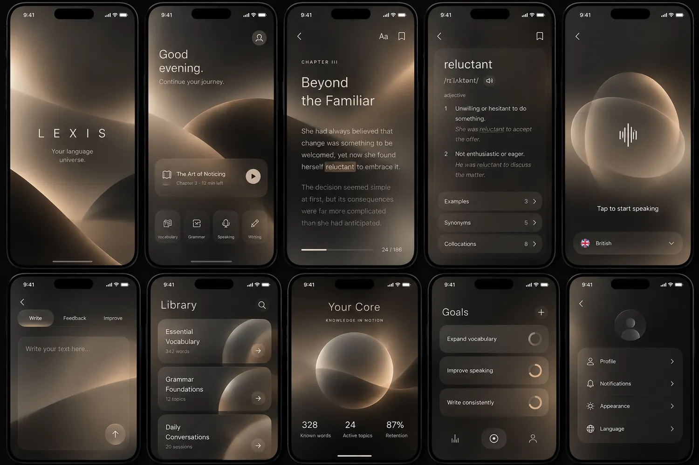
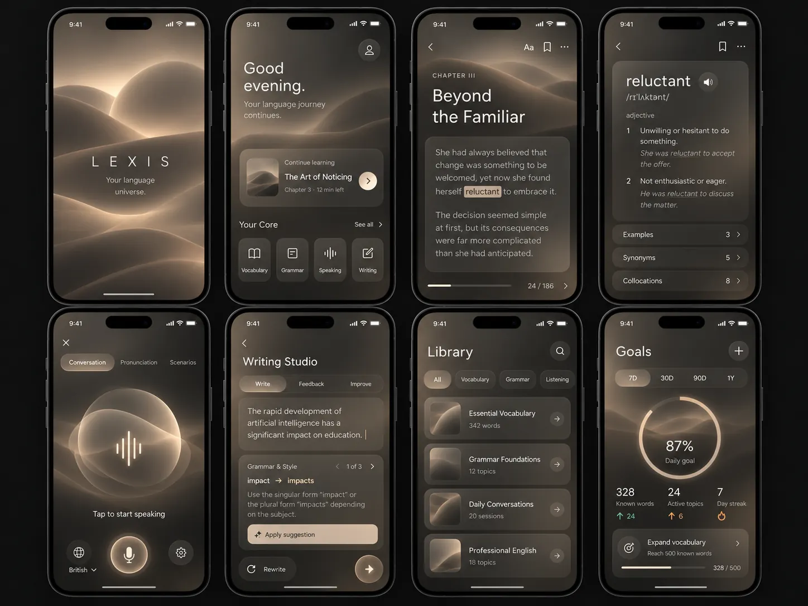
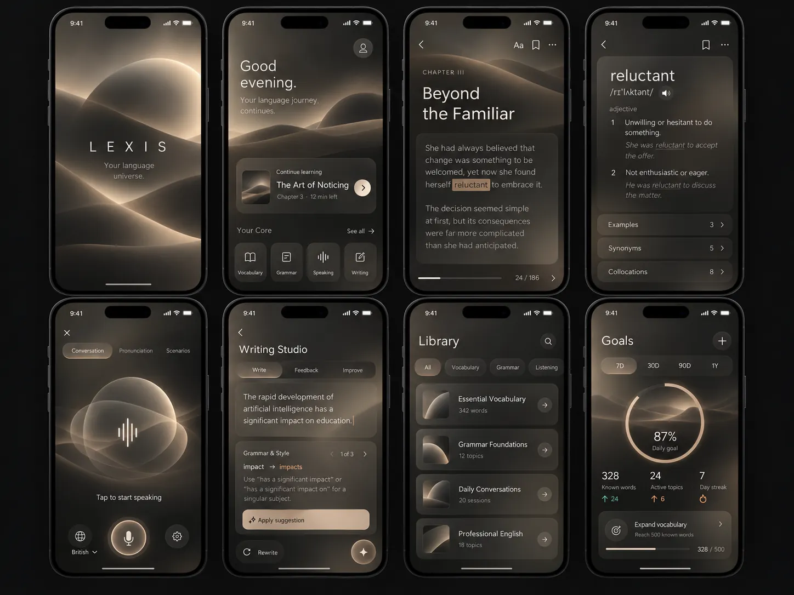
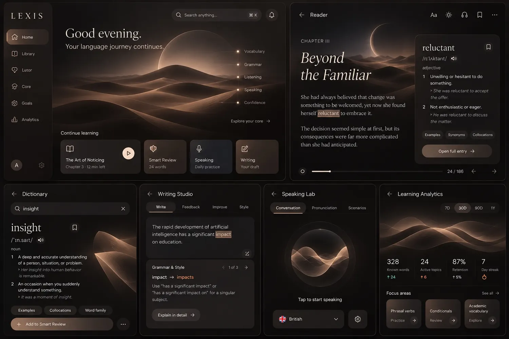

# LEXIS — ПОЛНАЯ СПЕЦИФИКАЦИЯ И ИНСТРУКЦИЯ ДЛЯ CODEX

Версия handoff v1.1 / 22 октября 2026. Консолидировано из обсуждений проекта; ссылки на реальные изображения работают относительно корня ZIP.

> Пользовательский запрос: сохранить всю продуктовую и визуальную информацию, включая 18 исходных изображений, и начать профессиональную разработку LEXIS.


---

<!-- SOURCE: CODEX_FIRST_MESSAGE.md | Начальное сообщение -->

# Первая команда для Codex — вставить в чат после загрузки архива

Ты — ведущий технический архитектор, design engineer и разработчик LEXIS. Я приложил `LEXIS_COMPLETE_CODEX_PACKAGE.zip`: это не просто вдохновение, а **передача полного ранее согласованного проекта** вместе с **18 оригинальными изображениями**.

**Сначала распакуй архив и прочитай `README.md`, `START_HERE_CODEX.md`, `AGENTS.md`, все документы в `docs/`, затем открой изображения из `assets/` и `contact_sheet.jpg`.** Если архив нельзя распаковать в текущей среде, сообщи о препятствии и работай с отдельным файлом `LEXIS_COMPLETE_CODEX_BRIEF.md`, пока исходные изображения не будут доступны. Не заявляй, что видел изображения, если их не открывал.

Не переизобретай концепцию. Все 14 модулей, центральная per-sense/per-skill knowledge model, Learning DNA, Knowledge Flow, AI Tutor, Reader, Smart Review и UX-навигация уже определены. **Последние визуальные требования:** iPhone-first, dark, extreme minimalism, очень мягкое запотевшее матовое стекло, тёплый дымчатый графит/espresso/песок; акцент на мягком Voice orb. Фон не должен выделяться за текстом, особенно в Reader, Dictionary, Writing. Ранние purple/noir/orbital варианты не копировать как финальный стиль. Образы скриншотов нельзя использовать как вместо рабочего приложения.

**Задача №1:** проверить существующий репозиторий и доступные интеграции, подготовить короткую архитектурную оценку и план. Далее создать дизайн-систему и первую реальную вертикальную цепочку Home → Reader → contextual lookup → Dictionary sense → Save → Smart Review; параллельно визуальный Voice prototype с честно помеченными заглушками. Собирать функциональный сайт на Next.js/React/TypeScript с Supabase через адаптер при доступности подтверждённой инфраструктуры.

Зафиксируй документы в репозитории, а задачи в Linear по мере доступности. Не делай вид, что идентификатор чата `01a16098-eb0b-716e-8a3a-4b6805a66069` сам по себе даёт доступ к прежним беседам. Источником истины являются приложенные спецификации и обновляемые `docs/`.

После первого технического аудита перечисли реальные существующие файлы, предлагаемые изменения, риски, неизвестные и следующие проверяемые шаги. Затем приступай к реализации. После каждого этапа показывай изменённые файлы, тесты, реальные скриншоты и ограничения, не обещая того, что ещё не работает.


---

<!-- SOURCE: START_HERE_CODEX.md | Инструкция запуска Codex -->

# КОДЕКС / СТАРТОВАЯ ИНСТРУКЦИЯ: LEXIS

## Роль и миссия

Ты — principal frontend engineer, full-stack architect, design engineer и ответственный исполнитель разработки **LEXIS**, премиального персонального AI-powered приложения для изучения английского. Этот пакет передаёт накопленный и согласованный продуктовый контекст из более ранних диалогов ChatGPT. Он должен исключить ненужное повторное проектирование.

**Не начинай с генерации случайного интерфейса.** Прежде всего прочти все материалы и реальные изображения. Приоритет — качество, техническая достоверность, корректная модель обучения и узнаваемый интерфейс, а не количество написанных строк.

## Точка входа

Прочитай по порядку:
1. `AGENTS.md`;
2. `docs/DECISIONS_AND_SOURCE_OF_TRUTH.md`;
3. `docs/PRODUCT_VISION.md` и `docs/MODULES_14.md`;
4. `docs/LEARNING_ENGINE.md`;
5. `docs/UX_FLOWS.md` и `docs/SCREEN_BLUEPRINTS.md`;
6. `docs/VISUAL_DESIGN.md`, `docs/REFERENCE_CATALOG.md`, `docs/REFERENCE_GALLERY.md`, просмотри **все** изображения `assets/` (их 18) и `contact_sheet.jpg`;
7. `docs/TECH_ARCHITECTURE.md`, `docs/INTEGRATIONS_AND_TOOLS.md`, `docs/QUALITY_AND_TESTING.md`, `docs/ACCEPTANCE_MATRIX.md`, `docs/ROADMAP.md`.

При конфликте приоритет: **последние чёткие указания владельца → документ утверждённых решений → продуктовая спецификация → референсы → инженерная реализация**. Визуальные референсы не имеют права переопределить требование читаемости или ограничения производительности.

## Главные аксиомы LEXIS

1. Единая персональная модель знаний, общая для Dictionary, Reader, Writing, Speaking, Listening, Tutor, Review, Grammar и Core.
2. Учёт **значения слова (`sense`)**, а не только текстовой формы (`lemma`): пользователь может знать одно значение и не знать другое.
3. Различать пассивное узнавание, понимание в контексте, самостоятельное воспроизведение, письменную продукцию, спонтанную устную речь. Уровень знания — вероятностная оценка по доказательствам, а не просто бинарный флаг.
4. Импорт слова не доказывает незнание; добавление в коллекцию не доказывает владение. AI не должен самоуверенно придумывать оценки.
5. AI Tutor интегрирован во все учебные потоки, объясняет и позволяет оспаривать оценки. Детектор речевых ошибок и оценщик произношения нельзя подменять обычной транскрибацией.
6. Приложение должно быть самостоятельным продуктом с мобильным интерфейсом **первым для iPhone Safari**, а не набором красивых статичных картинок.
7. UX: крайне минималистичный, тёмный, мягкий, премиальный, сильно матовое «запотевшее» стекло, тёплая дымчатая палитра графита/espresso/песка. Фон абсолютно вторичен при чтении/письме/словаре. **Голосовой помощник** — эмоциональный визуальный акцент, но без лишнего блеска и неона.
8. Полная стратегия развития охватывает все 14 модулей; **первый инженерный vertical slice**: Home → Reader → contextual word lookup → sense selection → save → Smart Review. Параллельно качественный прототип Voice UI. Потребительский первый релиз нацелен на полную связную систему, а не 14 фиктивных вкладок.

## Что делать сначала (без создания фиктивного результата)

1. Проверь доступный репозиторий, ветки, существующий код, переменные среды, уже созданные проекты и активные интеграции. Если ничего нет, честно укажи, что проект пустой.
2. Создай/сохрани docs и референсы как source of truth. Не перезаписывай пользовательские файлы без проверки.
3. Напиши короткий implementation plan, data model, риски, явные неизвестные, критерии приёмки.
4. На основе Next.js/TypeScript собери настоящую дизайн-систему с мобильными компонентами, токенами, типографикой, слоями glass, режимами reduced-motion и контрастом текста.
5. Реализуй первый сквозной сценарий через настоящие состояния и доменную логику. Локальный demo fixture допустим только как явно обозначенный режим до внешних API. Не путай заглушку с интеграцией.
6. Создай Voice screen с качественной лёгкой анимацией состояний idle/listening/processing/speaking/error; не утверждай, что есть распознавание речи, пока его нет.
7. Настрой typecheck, lint, unit tests, e2e при возможности, build и manual mobile checklist; реально запусти, что доступно.
8. При каждом этапе обновляй `docs/PROGRESS.md` и журнал решений; чётко сообщай, какие файлы изменены, что работает и что не проверено.

## Формат отчёта после каждого значимого изменения

- Цель и границы работы.
- Какие файлы изменены и почему.
- Что именно реализовано (реальное / демо / запланированное).
- Какие проверки выполнены, команды и итог.
- Скриншоты реального интерфейса, если доступно, и сравнение с референсами.
- Обнаруженные ограничения, риски, решение по следующему шагу.

## Интеграция с другими рабочими пространствами

Данный handoff может использоваться в чате Codex с идентификатором `01a16098-eb0b-716e-8a3a-4b6805a66069`, но **идентификатор сам по себе не даёт доступа к содержимому другого чата**. И ChatGPT, и Codex должны синхронизироваться через общий GitHub-репозиторий и `docs/`; продуктовые задачи — через Linear, если доступен. Не утверждай, что всё связано, пока это не проверено.

## Первое ожидаемое действие

Прочитать материалы и изображения; дать обзор непереопределяемых требований, архитектуру v1, дерева репозитория, модели данных и milestones. Затем переходить к Foundation + первым реализуемым экранам. Не пытайся имитировать все 14 модулей одновременно.


---

<!-- SOURCE: AGENTS.md | Правила Codex -->

# AGENTS.md — обязательные инструкции для Codex в LEXIS

## Source of truth
- Внимательно читать `README.md`, `START_HERE_CODEX.md`, `docs/DECISIONS_AND_SOURCE_OF_TRUTH.md` и прикладные документы перед изменениями.
- Не трактовать генерированные UI-референсы как production assets. Не заменять UI макетом-картинкой.
- Не перевыбирать продуктовые решения без необходимости. Неизвестные детали оформлять в ADR/open questions, отделять от утверждённых требований.

## Продукт
- Единая per-sense + per-skill knowledge model; независимые evidence and review state.
- Не превращать запись «изучено» или импорт в «знание».
- AI feedback объяснимый, оспариваемый и воспроизводимо логируемый; сомнительные ответы не штрафовать автоматически.
- Adaptive UX не должен скрывать полный доступ к данным и ручным настройкам.
- UX должен быть полезным без подключённых платных API: чёткий offline/demo mode, но без обмана относительно AI/voice.

## Engineering
- TypeScript strict, понятная модульная структура, явно отделённые домен/приложение/инфраструктура/UI.
- По умолчанию React + Next.js + Tailwind/CSS tokens + Motion, PostgreSQL/Supabase за адаптером.
- Не добавлять тяжёлые зависимости, Rive/GSAP, vector DB или микросервисы без подтверждённой необходимости.
- Предпочитать мало зависимостей, детерминированную логику и тесты.
- Проверять latest API docs перед интеграциями; не придумывать SDK endpoints. Context7/веб-документация для актуальных API.
- Не размещать API keys в browser bundle, не использовать credentials без разрешения.
- Тесты: домен, оценивание, импорт, SQL policies, критичный Reader→Dictionary→Review, Safari/mobile smoke.
- Responsive + iPhone Safe Areas, taps min ~44 CSS px, keyboard/viewport behavior, `prefers-reduced-motion`, contrast.
- Избегать крупномасштабных blur/backdrop-filter и постоянных тяжёлых GPU effects; предпочитать фиксированные полупрозрачные слои/gradients и локальные blur.

## Collaboration
- Изменять код малыми логичными шагами. Не переписывать файлы без анализа текущей версии.
- Описывать trade-offs и принятые решения в `docs/DECISIONS_AND_SOURCE_OF_TRUTH.md` или ADR.
- После задачи: команды тестов и точные результаты; не объявлять успешно непроверенное.
- Внешние операции, деплой, публичные URL, платные API и изменения production schema согласовывать при необходимости.
- В кодовых комментариях и пользовательских интерфейсах придерживаться профессиональной нейтральности; не переносить стиль общения чата в продукт.


---

<!-- SOURCE: docs/DECISIONS_AND_SOURCE_OF_TRUTH.md | Утверждённые и неутверждённые решения -->

# Решения, ограничения и неизвестное

## УТВЕРЖДЕНО / считать контрактом продукта
1. Название: LEXIS; английский, включая RU assistance.
2. 14 основных модулей из `MODULES_14.md`; Knowledge Flow и общая knowledge model — центральный механизм.
3. **Sense-level** учёт, per-skill evidence; импорт ≠ незнание; добавление ≠ знание.
4. Режимы Quick / Focused / Free Exploration / Goal Training.
5. AI Tutor стили Mentor / Examiner / Companion, корректировка уровня исправлений.
6. Session types: Guided Lesson, Conversation Lab, Weakness Workshop, Real-Life Simulation, Knowledge Check.
7. Balanced Living Home, гибрид Living Core + быстрый возврат к текущей работе.
8. Верхнеуровневая навигация Home / Library / Learn / Tutor / Core.
9. Contextual Workspace: Quick Interaction / Context Panel / Dedicated Workspace / Persistent Context.
10. Dictionary Quick View / Full Entry / Deep Dive; Reader adaptive assistance, My Understanding; Writing adaptive feedback vs style; Voice Live и Push-to-Talk.
11. Grammar Atlas: hybrid structured + contextual; Analytics: Living Core + Knowledge Observatory; Goals совместные и корректировки с подтверждением.
12. Smart Inbox для импорта вместо автоматического назначения всех карточек.
13. Smart Review на принципах FSRS + varied practice и AI verdict appeal.
14. UI dark-only currently, iPhone-first, extreme minimalism, high-legibility matte fogged glass, desert/mid-century color feeling without furnishing imagery.
15. Мягкие rounded, medium-weight typography, spacious surfaces, subtle gradients, voice orb/wave, not overwhelming background.
16. Mobile PWA и полноэкранные Reading/Voice workspaces.

## СИЛЬНЫЕ ПРЕДПОЧТЕНИЯ / не терять
- Голосовой помощник наиболее удачная часть последних макетов.
- Строгий запрет на конкуренцию декора с текстом, особенно Reader, Dictionary, Writing.
- Цвета warm graphite/espresso/smoked walnut/sand/ivory, не ярко-фиолетовый, не агрессивно-бронзовый, не interior imagery.
- Сильная, но матовая «запотевшая» фактура. Умеренные анимации, без эффекта бесконечного свечения.
- Пользователь ценит ощущение премиальной вещи, а не обычного учебного кабинета.

## ПРЕДПОЧТИТЕЛЬНЫЙ, НО ЕЩЁ НЕ УТВЕРЖДЁННЫЙ КОНКРЕТНЫЙ ВЫБОР
- Framework: Next.js/React/TypeScript/Tailwind/CSS tokens/Motion, Postgres/Supabase, Vercel, GitHub.
- Rive для Voice, если производительность и лицензия оправдывают; иначе SVG/CSS/Motion.
- FSRS algorithm library/version нужно подобрать и проверить; не выдумывать «идеальную точность».
- Azure Speech pronunciation scoring, ASR/TTS, AI provider, словарные API, embeddings, observability требуют выбора, тарифов и проверки качества.
- Любые точные цвета, размеры и шрифты из референсов — **направление**, не утверждённые production tokens. Codex должен предложить разумные значения и предъявить реальные скриншоты для сравнения.

## НЕ ИЗВЕСТНО / НЕЛЬЗЯ ПРИДУМЫВАТЬ
- Есть ли уже GitHub-репозиторий, Supabase проект/ключи, Vercel deployment, Linear workspace/project.
- Доступность конкретной GPT-6.1 модели в API/на тарифе, её качество/цена.
- Наличие лицензий на Oxford/Cambridge/другие словари и книги.
- Финальное бренд-лого, платные планы, дата запуска, бюджет инфраструктуры.
- Утверждённые production-метрики, целевой retention, содержимое реальных пользовательских словарей.
- Наличие живого speaking assessment / stream API.

## Коллизия: «Complete Experience» vs «vertical slice»
Это **разные горизонты**, не противоречие: первый инженерный срез небольшой, первое осмысленное публичное предложение должно быть цельным по навыкам.

## Коллизия: изображения vs финальный feedback
Изображения — визуальные эксперименты; последние отзывы пользователя важнее. Не копировать непрозрачность фона, композицию или плотность карточек, если это мешает тексту или минимализму.

## Обновления
При изменении требования указать дату, инициатора, rationale, impact и связанные файлы. Не переписывать прошлые решения молча.


---

<!-- SOURCE: docs/PRODUCT_VISION.md | Концепция продукта -->

# Product Vision, audience, learning values

## One-liner
**LEXIS** — персональная интеллектуальная среда изучения английского языка, в которой чтение, письмо, аудирование, говорение, грамматика, словарь и повторы соединены общей моделью знания.

## Не учебник и не ещё одно приложение карточек
Задача не максимизировать streak, а помогать переносить знания между контекстами: прочитал → понял значение → использовал письменно → произнёс → закрепил спустя время. LEXIS должен быть умным, но не навязчивым. AI Tutor — слой педагогики везде, а не один чат-бот за кнопкой.

## Первичный сценарий и персонализация
- Основной пользователь: самостоятельно изучает английский, хочет учить слова из Reverso и англоязычных книг, общаться и применять язык в IT, бизнесе и работе.
- Гибкость для общего английского и иных целей (разговорный, академический, профессиональный). Не зашивать образовательную специализацию одного человека в код.
- EN/RU/mixed interface modes, разные объяснения; возможность сменить способ объяснения при непонимании.
- Learning DNA: заявленные предпочтения + наблюдаемые привычки, с прозрачным разделением.
- Placement: опциональный стартовый тест + дальнейшая оценка по доказательствам, без навязанного длинного onboarding.

## Педагогические принципы
- Evidence-based, а не псевдо-точность.
- По возможности разные виды recall/production, вариативные контексты, полезная обратная связь.
- CEFR — приблизительная характеристика контента и навыка, не гарантированный «официальный уровень».
- Оптимизация retention и transfer, а не только цифры добавленных слов.
- Контроль ученика: исправления AI можно оспорить; подсказки регулируются; не обязательно следовать расписанию.
- Достаточно информации для осознанного решения, но без информационной перегрузки.

## Product north star
Пользователь возвращается к реальным текстам и разговорам, понимает и использует больше языка и видит достоверное прогрессирование между навыками.

## Scope и этапы
- **Конечная продуктовая концепция:** 14 взаимосвязанных модулей, персонализация и Knowledge Flow.
- **Первая версия, которую пользователь назвал Complete Experience:** должна ощущаться связной средой во всех основных модальностях; приоритет честной работоспособности, а не муляжам экранов.
- **Первый этап инженерной разработки:** одна отлично работающая вертикальная цепочка Reader → lookup → save → review, параллельно визуальный голосовой экран. Это шаг, **не вся стратегия релиза**.

## Что не делать
- Не смешивать passive/active знание в одно число.
- Не показывать числа «известных слов» без определения методики подсчёта.
- Не считать случайное нажатие доказательством усвоения.
- Не делать AI-оценки необжалованными.
- Не выдавать чужой лицензированный словарь за собственный открытый контент.
- Не вставлять отвлекающиеся декоративные элементы между учеником и текстом.


---

<!-- SOURCE: docs/MODULES_14.md | 14 модулей и дополнительные функции -->

# Функциональные модули LEXIS: подробная карта

Все модули используют одну систему идентификаторов слов/значений (`lemma`, `sense`) и общую историю доказательств (`learning_evidence`). Уровень знания не живёт независимо в 14 разных таблицах.

## 01. Intelligent Dictionary
- Поиск по слову, форме, фразе, переводу, контексту. Lemmatization и disambiguation.
- Один `lexeme` → несколько `senses`; POS, формы, транскрипция IPA, BrE/AmE audio, definition EN, перевод RU (если доступен и легален), грамматика управления, collocations, synonyms/antonyms, register, CEFR estimate (source-qualified).
- Контекст из Reader/Writing/Voice переносится в Quick View и рекомендует **значение**, не подменяя выбор пользователя.
- UI глубина: Quick View → Full Entry → Deep Dive.
- Содержимое должно иметь source, license, version, uncertainty; сгенерированные AI толкования не выдавать за лицензированный словарь.
- Add to Knowledge с изменяемым study intent и источником контекста; сохранить возможность изучать альтернативные значения позже.

## 02. Bulk Import / Smart Inbox
- Paste, TXT, CSV, XLSX, по доступности экспорт Reverso. Не обещать прямой доступ в закрытый аккаунт Reverso без интеграции.
- Preview rows, file encoding, empty/error report, source contexts, manual correction, duplicate detection by normalized lexeme + sense/context.
- Disambiguation uncertain imports, merge vs split, source metadata, undo/rollback, import status, batch selection.
- «Импортировано» не означает «не знаю». В обзор новых карточек отправлять выборочно, не все слова разом.

## 03. AI Verification / Challenge
- Evidence-backed проверки владения конкретным sense и skill.
- Политика rubric: самостоятельность, контекст, допустимые синонимы, грамматическая пригодность, степень подсказок, тип ошибки.
- Разделять deterministic grading (где возможно) и AI judgement; AI confidence / uncertainty.
- Возможность «Оспорить оценку», ручное исправление, журнал пересмотра; воспроизводить reason и исходный контекст, минимизируя сохранение чувствительных данных.

## 04. Smart Spaced Repetition
- FSRS-inspired scheduling per item/sense with ability/skill evidence; не ломать систему единого знания отдельной «правдой» карточек.
- Форматы recognition/production, translation, context gap, synonym discrimination, listening, speech, reading recall.
- Учёт качества ответа, hints, response modality, answer latency only if meaningful, lapse, interference, contextual variety.
- Не ухудшать оценку пользователя из-за неправильного AI judgment; schedule transparent and user-adjustable.

## 05. Voice Practice
- Modes Live Conversation и Push-to-Talk; mentor/examiner/companion styles, topic and goal.
- State machine: idle, permission, listening, processing, speaking, paused, recovery/error.
- Clear audio controls, language/accent selection, transcript visibility, correction intensity, post-session evidence review.
- ASR transcription != reliable phonetic assessment; separate pronunciation evaluator when integrated, uncertainty display.
- Dialogues, scenario practice, shadowing, repeat and repair; user may choose delayed/inline correction.

## 06. Semantic Network
- `sense`→`sense` typed relations: synonym, antonym, entailment, hypernym, collocation, often-confused, morphologic.
- Personal network of learned concepts + contexts, with filters and explainable edges; no explosion of unvalidated links.
- Small, navigable visual map, not an unreadable orbital visualization.

## 07. Analytics / Knowledge Observatory
- Separate activity vs retention vs demonstrated comprehension/production vs pronunciation (where valid).
- Trends over time, source diversity, confidence, goals, knowledge gaps and uncertainty; explain how figures are computed.
- Living Core = immediate affective orientation, Knowledge Observatory = detail and rigorous metrics.
- Privacy-preserving event instrumentation; no unconsented transmission of actual books/essays/voice transcripts.

## 08. Text Extraction & Contextual Lookup
- Paste selected text, import document where legal; tokenize safely, segment sentences, preserve original user text.
- Click/select expression, lemma/sense resolution, definitions, contextual examples; avoid accidental spoilers.
- Distinguish phrase/idiom vs single word, idiomatic meaning; low-confidence mapping asks for selection.

## 09. LEXIS Reader
- Import TXT, EPUB (where supported and DRM-free), pasted text; library status, chapter, progress, highlights, bookmarks, reading goals.
- Fluid typography, adjustable reading mode, font/size/spacing, theme contrast, progress, optional TTS, focus states.
- Tap word/phrase → contextual Quick View → select meaning → save / skip → return exactly to reading position.
- 'My Understanding' self-explanation, comprehension prompts and gentle AI feedback; help only on demand, avoid spoilers.
- Respect copyright/licensing, no DRM circumvention; user-provided content remains private.

## 10. Smart Cards
- Variety in modality + evidence; multiple acceptable answers, alternative phrasing, escalation from recognition to production.
- AI grading with reasons and Challenge; deterministic scoring for objective formats.
- Compact microinteraction, tactile visual feedback, accessibility and no shame-based gamification.

## 11. Writing Studio
- Free write, essay, email, topic prompts, business/IT writing if chosen; personal corpus from consenting user materials.
- Modes Write → Feedback → Improve; separate errors (grammar, meaning, vocabulary) from optional style suggestions.
- Explain-why + revise-yourself before auto-apply; version history, comparisons, user discretion.
- Knowledge evidence only when user independently produces target sense; auto-correct acceptance does not prove mastery.

## 12. Listening Studio
- Audio/video/transcript source with rights; transcript progressive reveal, shadowing, chunks, repetition, speed control (where audio provider supports).
- Follow listening → comprehension check → targeted vocabulary → spaced recall, with source trace and uncertainty.
- Distinguish reading transcript from actual listening comprehension in knowledge scoring.

## 13. AI Tutor
- Context-aware persistent pedagogical agent: knows current workspace/session, learning goals, evidence, not merely a generic chatbot.
- Modes Mentor / Examiner / Companion, adaptable correction style, Explain Differently, ask-for-example, non-intrusive suggestions.
- Sessions: Guided Lesson, Conversation Lab, Weakness Workshop, Real-Life Simulation, Knowledge Check.
- Tutor recommendation should cite the user’s own evidence in understandable language and avoid claiming definitive language level.
- Explicit permission for cross-module context; boundaries for personal corpus/private texts; deletion/export.

## 14. Grammar Atlas
- Structured grammar map + contextual deep dive when student encounters grammar in Reader/Writing/Voice.
- Concise rule, contrastive examples, common confusions, transfer exercises, revisit schedule.
- Grammar evidence distinct from word sense evidence; cannot infer grammar competence just because user read a sentence.
- Personalized weakness links, confidence and appeal.

## Сквозные функции (в дополнение к 14)
1. **Memory:** meaningful retrieval of contexts and studied patterns, controlled retention.
2. **Mistake DNA:** categorization and recurrence of mistakes, no stigmatizing labels.
3. **Deep Dive:** deeper linguistic and pragmatic explanations as progressive disclosure.
4. **Immersion:** EN/RU/mixed language support, adjustable by level and task.
5. **Shadowing:** repeat-after-listening and speech flow practice.
6. **Challenge:** dispute AI assessment and preserve validated user corrections.
7. **Personal Corpus:** user-owned examples with privacy controls.
8. **Goals:** co-authored targets with explicit confirmation of suggested adjustments.
9. **Explain Differently:** alternative explanation form, examples, analogy, step-by-step.
10. **Knowledge Gaps:** identify skill-specific underdeveloped contexts and offer targeted practice.

## Shared UI mechanics
- Home cards resume last meaningful activity, do not flood screen with 14 links.
- Command search across content/context, respecting privacy.
- Notification/inbox should be opt-in, flexible, no dark patterns.
- Consistent 'learned', 'recognizing', 'can produce' vocabulary must be explained to user and defined in code.


---

<!-- SOURCE: docs/LEARNING_ENGINE.md | Движок знаний и Knowledge Flow -->

# Единый обучающий движок: domain model / learning science / evidence

## Центральная гипотеза
Ключевой объект: `sense` (значение слова или устойчивого выражения), и его владение по **навыкам**, контекстам и времени. Один и тот же `lexeme` может обладать несколькими meanings с резко различающейся доказанностью.

### Базовые сущности
- `Lexeme`: headword/lemma, POS, language, normalization, inflection links.
- `Sense`: meaning ID, version, definitions/translations, provenance, sense-level CEFR estimate with uncertainty.
- `UsageExample`, `Collocation`, `Pronunciation`, `LexicalRelation`: многозначные ссылки и права использования.
- `UserLexicalItem`: пользователь связывает lexeme/sense с причиной изучения, context ID, imported source, priority/status. Не уровень знания.
- `LearningEvidence`: append-only наблюдение с user, sense, `skill`, task type, modality, result, hint usage, independence, context, timestamp, uncertainty, source, evaluation policy version, challenge status.
- `CompetenceEstimate`: derived projection, not necessarily mutable single field; per (user, sense, skill) score/confidence/observations/updatedAt.
- `ReviewItem`, `ReviewEvent`, `ReviewSchedule`: schedule learning spaced recall; different from evidence and competence, but produces evidence.
- `LearningSession`, `TutorRecommendation`, `GrammarConcept`, `WritingRevision`, `ReadingLocation`, `Goals`.
- `PersonalContext`: user-owned content with explicit scope, rights, retention and deletion.

### Предпочтительная онтология навыков
- recognition: can recognize candidate in isolation;
- contextual_comprehension: interprets use in a passage;
- recall: retrieves word or sense without answer options;
- writing_production: independently uses sense correctly in written output;
- spontaneous_speech: independently uses sense correctly in fluid conversation;
- listening_comprehension: understands heard sense without transcript;
- pronunciation: phonetic performance (separate measurement, with validation);
- grammar: a distinct grammar concept competency, not a direct sense score.

Эти названия — предлагаемая инженерная модель, не UI taxonomy. Не смешивать такие measurements в единую уверенную цифру без методологии.

## Evidence update mechanics
1. Learning event references exact task, context and expected sense.
2. Evaluation policy deterministic where possible; optional AI rubric with confidence and alternatives.
3. Append evidence event, including «invalid / challenged» status.
4. Derived estimates recalculated from valid evidence; confidence considers quantity, age, difficulty, hints, transfer between contexts.
5. Review scheduling consumes meaningful outcomes, not click events; preserve history for re-evaluation.
6. User sees simple natural-language explanation: «вы понимаете смысл в тексте, но пока редко используете его без подсказок».

**Do not fake calibrated probabilistic percentages.** Если не проведена калибровка на реальных данных, UI обозначает уровень как tentative, не «87% mastery».

## FSRS and Smart Review
- Use publicly documented, reproducible FSRS implementation/version when selected. FSRS provides interval planning, not semantic competence proof.
- Map training objective to stable review item: same sense + skill + prompt type or shared history, depending on empirical testing.
- Need policy for when multiple cards targeting same sense share or separate scheduler state. Keep decision recorded.
- Accept alternative valid translations/expressions, avoid penalties on ambiguous prompts.
- Promote recognition → recall → applied writing/speaking progressively, without guaranteeing automatic transfer.
- Intelligent workload: caps, due queue, fatigue, user control, postponed reviews.

## Challenge of AI assessment
Rubric must log expected meaning, admissible alternatives, context, model assessment, confidence, revised judgement. User can challenge, provide intended interpretation, and optionally mark correction. Challenge affects future competence and schedule by reconciliation, not only changing UI message. Avoid storing verbose private texts unnecessarily.

## Knowledge Flow
- Reader lookup recommends dictionary sense with context.
- Saved sense adds to Smart Inbox and candidate review, linking original passage.
- Writing using sense produces stronger production evidence than reading exposure.
- Voice conversation may produce speaking evidence (if transcription and evaluation reliable).
- Listening without transcript gives listening-specific evidence.
- Grammar errors connect to Atlas and focused Tutor session.
- Mistake DNA connects repeated error patterns to weakness workshops.
- Knowledge Observatory displays meaningful progression, with uncertainty and source of evidence.
- Every cross-module operation must be explainable and reversible where appropriate.

## Anti-patterns
- Marking sense «known» on import/add.
- Mistaking AI-generated correction acceptance for spontaneous skill.
- Using pure ASR confidence as pronunciation grade.
- Using a binary database flag as whole knowledge model.
- Automatically linking all similar-looking words as synonyms.
- Showing exact CEFR for each definition without caveat or source.

## Example minimal event (illustrative, not a frozen schema)
```json
{
  "event_type": "answer_evaluated",
  "sense_id": "sense_reluctant_01",
  "skill": "contextual_comprehension",
  "modality": "reader_check",
  "is_independent": true,
  "hints_used": 0,
  "result": "accepted",
  "confidence": "high",
  "review_required": false,
  "evaluation_version": "rubric_v1",
  "source_context_id": "reading_highlight_id"
}
```
The ID and values above are examples, not actual reference dictionary IDs or user data.


---

<!-- SOURCE: docs/UX_FLOWS.md | UX и сценарии -->

# UX, IA, navigation, contextual workspaces

## Navigation
**Five primary destinations:** Home, Library, Learn, Tutor, Core. Mobile bottom navigation with icons + accessible labels, deliberate hierarchy; desktop sidebar (not desktop-first controls shrunk to mobile). Universal **LEXIS Command** lets user search lexemes, senses, books, cards, grammar and actions.

### Home — Balanced Living Home
- Greeting + calm small message; user-controlled resume card above the fold.
- Living Core as tactile subtle focal area indicating overall learning, not false pseudo-science.
- Quick access to continue Reader / Voice / Review, personalized recommendations grounded in evidence.
- Allow dashboard without interrupting focus or presenting 14 large cards.
- Useful empty state for brand-new user; don't fabricate streaks/metrics.

### Library
- Books/documents, imported vocabulary, curated study collections, sources, search/filter, progress.
- Smart Inbox for imports, duplicate triage, unfinished study candidates.

### Learn
- Guided Lesson / Review / Grammar Atlas / Listening / Writing; goal-based discoverability.
- Contextual assistant and continuation, Quick / Focused / Free Exploration / Goal Training.

### Tutor
- Dedicated conversation interface, text and voice entry, adaptable styles Mentor/Examiner/Companion and session types.
- Explain assessment, allow corrections and change teaching approach; retain context only when allowed.

### Core
- Living Core primary portrait + Knowledge Observatory detail. Skills across comprehension/writing/speech/listening, goals, semantic connections, evidence provenance.
- Explain what measurement means; avoid claims like «328 words known» unless computation is defined.

## Workspace model
1. **Quick Interaction**: mini-card popover, quick lookup, one tap action.
2. **Context Panel**: expandable detail while retaining underlying activity.
3. **Dedicated Workspace**: fullscreen Reader, Voice, Writing where task warrants.
4. **Persistent Context**: source highlights, progress, conversation context retained across transitions.

## Onboarding
- Welcome + goals, optional language placement, allow skipping.
- Self-reported preferences vs inferred Learning DNA always distinguished.
- Show 2–3 helpful actions rather than forced 20-step survey.
- Invite Reverso import or adding first book; let user choose.
- Accessibility/screen reader, voice permissions when voice first used, not universally on opening app.

## Critical journey A: Reader to review
1. User opens own legal TXT/EPUB or seeded **clearly labelled demo** sample.
2. Text is focus-optimized, clear sans/reader mode; line width, font size, spacing controllable.
3. Tap/long-press `reluctant` → anchored Quick View, preserves position and selection.
4. Contextual disambiguation suggests sense with visual affordance to change it; displays usage and audio where available.
5. User taps «Save for learning»; app tracks source passage/context/meaning and pending study intent, not inferred ignorance.
6. Continue reading without losing place.
7. Later review queue shows appropriate contextual retrieval prompt, not an obvious multiple-choice only.
8. Answer updates evidence and review schedule with honest explanation; corrections can be contested.

## Critical journey B: Import vocabulary
Paste/export file → inspect source → preview/normalize/dedup → sense ambiguity → accept/edit/reject → Smart Inbox → individual study plan → contextual use. Must handle 1k+ entries incrementally without browser lock-ups.

## Critical journey C: AI Tutor help
Open from current Reader passage → Tutor knows highlighted text with permission → asks what type of help needed → concise answer with meaning and alternatives → optional training item → return to exact reading position.

## Critical journey D: Writing → Grammar
User drafts → optional check → feedback sorted errors vs style → sees why, edits himself → grammar concept link → tailored exercise → evidence only on independent production.

## Critical journey E: Voice
Launch fullscreen → permission/onboarding → choose live or push-to-talk → clear microphone state → listen/speak → delayed or inline feedback based on preference → transcript if enabled → recap with uncertainty, pronunciation assessment only if specialized scorer available.

## Design states (every screen)
- Empty first use, loading/skeleton, successful with real data, permission denied, offline, timeouts, unavailable API, error, retry, save and undo, keyboard open, accessibility label, reduced motion.
- Support dark soft keyboard viewport, Safari dynamic toolbars, safe-area bottom inset, selection/context menu, back navigation, session restoration.

## Desktop adaptation
Preserve desktop reading and writing max line length, sidepanel dictionary, left navigation, optional double-pane Reading. Desktop is extension, not new product.

## User control
Adaptivity recommendations explicit and dismissible; confirmation for adjusting goals; provide full manual navigation, export/delete personal learning data, adjust correction intensity and language mode.


---

<!-- SOURCE: docs/SCREEN_BLUEPRINTS.md | Поэкранные макеты и поведение -->

# Detailed screen blueprints for visual engineering

These describe behavior/content priorities, not frozen screenshots. All components must be responsive DOM, accessible and backed by real state or explicit demo fixtures. The final aesthetic is defined by `VISUAL_DESIGN.md` and reference gallery.

## Global shell and navigation
- **Mobile**: top safe area respect dynamic island / status bar; navigation between Home, Library, Learn, Tutor, Core; minimalist icons with labels or discoverable stable names; bar low-salience frosted glass, never obscures content; safe-area aware.
- **Desktop**: quiet sidebar; content centered, max reading width; contextual secondary panel for lookup/details.
- Universal search / LEXIS Command: lexeme, sense, document, lesson, quick action; keyboard shortcut desktop, clear touch affordance mobile.
- Theme first is dark-only; bright theme not required yet. User locale EN/RU/mixed, language toggles in settings.

## 0. Entry / Splash / pre-auth
- Single sculptural dune-like soft volumetric gradient and compact LEXIS wordmark. No giant logo gradients or unnecessary screen transition delays.
- Tactile calm atmosphere and no false onboarding progress.
- On first run, optional placement, objective selection, skip, import and reading choices. Avoid forcing account creation for a purely illustrative trial if product architecture permits.

## 1. Home / Balanced Living Home
**Primary hierarchy:** greeting (short) → resume learning (book/voice/review) → subtle Living Core or current momentum → contextual next action(s) → quick routes.
- User should know what to do in 3 seconds.
- Content states: no content/new user, reading-in-progress, due cards, insufficient evidence, returning after break, offline.
- Widgets are not mandatory just because the reference shows them. Prefer generous margins and 2–3 strong elements.
- Decorative warmth may appear in ambient header but recedes behind paragraphs.

## 2. Reader fullscreen
**Primary hierarchy:** chapter and reading text, uncluttered. Top bar back, reading options, bookmark. Bottom optional page/progress, hidden on immersive focus if user chooses.
- Tap versus long-press needs native interaction design. Avoid breaking iOS text-selection handles or standard copy behavior.
- Context popover/backdrop anchoring reflows safely near edges; word highlighting must not swallow selection.
- Controls font size, line spacing, optionally serif reading typography if user chooses, not forced.
- Book progress based on stable structural location, not just scroll pixel.
- Reader supports 'My Understanding' optional per segment, skip and revisit; spoiler-aware AI.

## 3. Dictionary Quick View
- Display selected surface form and lemma (where different), suggested sense and confidence, IPA/variant and audio only if verified source available.
- Definition EN, concise RU gloss, usage example from licensed source or clearly generated/private context, save action, expand to Full Entry.
- Ambiguous multiple senses list, manual override and appeal. Keep no more than necessary in first panel.
- On save, status indicates added to study pool, not 'mastered'.

## 4. Dictionary Full Entry / Deep Dive
- Full senses with grouped POS, pronunciations, examples and collocations with provenance, labels like register and contextual suitability.
- Deep Dive: nuances, synonyms, confusions, grammatical patterns, mnemonic or explanation variants; low-confidence AI additions distinctly labeled.
- Scroll and sticky controls not trap reading position. Long content has progressive sections.

## 5. Voice Practice fullscreen
- Surface dominated by single tactile fogged translucent orb with minimal mic/wave center icon.
- States: idle (quiet ready), permission prompt (explain), listening (soft response), processing (non-thrashing), speaking (subtle responsive), paused, timeout, error, network recovery.
- Actions: tap/hold microphone depending on live/PTT selection, transcript option, accent/language, scenario choice, exit, privacy/recording control.
- Post-session: short useful recap, strongest skill evidence only if ASR/evaluator validated; show uncertainty where needed.
- Require no endless purple glow, no heavy sphere on busy background. Reduced motion static orb communicates state in text/icon.

## 6. Library / collections
- Real book cards with cover only if owned/license permitted; otherwise elegant typographic/abstract placeholders.
- Rows: Continue reading, Your documents, Vocabulary/collections, Smart Inbox; search, import.
- Each collection displays count and activity semantics accurately (e.g., 342 added, not 342 known).

## 7. Learn hub
- Quick/Focused/Free Exploration/Goal Training switch or natural controls.
- Low-stress recommended next practice, due reviews, Grammar Atlas, Listening, Writing.
- Session picker Guided Lesson / Conversation Lab / Weakness Workshop / Real-Life Simulation / Knowledge Check.
- Avoid showing all study activity cards at once.

## 8. Smart Cards / Review
- Prompt-first visual, private low-distraction focus. Response may be text, speech, selection or listening.
- Clear 'show hint', submit, evaluated outcome, why, challenge, next. Make it impossible to confuse a visually green tick with knowledge proof absent valid rubric.
- Accessible feedback with proper keyboard/SR support and undo when grading uncertain.

## 9. Writing Studio
- Writing canvas with stable contrast and hierarchy, no decorative bright dunes behind text.
- Modes Write/Feedback/Improve, text length, autosave/versioning, optional rubric per task.
- Inline highlights separated as errors vs style opportunities. Original text always preserved; applying improvement is explicit.
- Grammar Atlas link shows compact context panel; return to draft with caret/scroll restoration.

## 10. Listening Studio
- Audio focus, waveform/progress, speed/repeat chunks, transcript reveal steps.
- Comprehension without revealed transcript tracked separately from aided replay/reading.
- Shadowing optional; accuracy estimates explained.

## 11. Tutor
- Minimal conversational interface; contextual header identifies Current Reader/Grammar/Goal only with permission.
- Mentoring mode selector is unobtrusive; progress from specific observed difficulty, not generic advice.
- AI outputs are streaming-capable, retryable, distinguish assisted explanation from assessment.
- Focused exercise cards embed via shared component library and return evidence to core domain.

## 12. Core / Knowledge Observatory
- Opening as sculptural Living Core + evidence-grounded explanatory summary, not a dashboard filled with numerical rings.
- Detail per skill, sense, time, review needs, goals; clear distinction between activity and demonstrated knowledge.
- Semantic Network optional deeper panel; no confusing visualization by default.
- Handle few-data/no-data without invented percentile scores.

## 13. Goals
- User chooses target; Tutor proposes if useful and user confirms any adjustments.
- Long-term, short-term, study cadence and domain objectives; progress with source, confidence and user control.
- No penalty/shame for days off; avoid fabricated motivational 'streak' claims.

## 14. Settings / Profile
- Language/immersion (EN/RU/mixed), accent BrE/AmE, correction density, narration/transcripts, accessibility/reduced motion, privacy controls, export/delete, connected services.
- Private recordings/transcripts default retention explicit and configurable.

## Surface priorities by content density
- **High expression/illustration:** splash, some Home atmosphere, Voice orb, Core.
- **Medium expression:** Library and Goals; decorative material confined to card backgrounds.
- **Near-zero decoration behind text:** Reader, Dictionary definitions, Writing canvas, Tutor long responses, Grammar lessons.

## UI review constraints
- Target screen screenshots must be from built app, not the 18 reference images.
- Verify with populated text, long Russian translations, long book paragraphs and keyboard; a layout that only handles 1-sentence AI mockup is not complete.


---

<!-- SOURCE: docs/VISUAL_DESIGN.md | Визуальная спецификация -->

# LEXIS Visual Design System — extremely detailed direction

> **TOP PRIORITY:** This product is not generic EdTech and not a neon AI dashboard. It should feel like an extremely refined, warm, quiet, fogged-glass interface, purpose-built for iPhone. Text content is sacred: decorative landscape/gradients never compete with reading, dictionary or writing.

## 1. История итераций и что пользователь отверг
Пользователь неоднократно пересматривал варианты. Концепты Aubergine Theory, Graphite & Ivory, Nocturne, Orbital, Eclipse, Noir Minimal, Aurora и более эффектные графитово-бронзовые композиции не были безусловно утверждены. Требования к последней итерации: **ещё сильнее минимализм, больше запотевания и мягкости, фон заметно тише, голосовой помощник нравится особенно**, скриншоты-референсы приложены в `assets/`. Не трактовать любой одиночный макет как финальную утверждённую работу.

## 2. Emotional brand signature
- Calm, intelligent, private, understated premium.
- Quiet energy, not gamer aesthetic or cryptocurrency UX.
- Warm atmospheric darkness, not black-and-white clinical, not glossy metallic bronze.
- Shapes recall dune contours, soft earth/stone, lacquered mid-century materials **only abstractly**.
- No photographs of luxury interiors, chairs, bedrooms, desert stock photography inside working UI.
- User’s concept words: desert / dune / mid-century feeling; expressive Voice orb; fogged glass; minimalism; spacious, fluid forms.

## 3. Color system (proposed direction, values pending visual validation)
Avoid blindly hardcoding sampled screenshot pixels. Derive semantic tokens (`surface`, `surface-muted`, `surface-elevated`, `text-primary`, `text-secondary`, `accent-warm`, `accent-focus`, `glass-fill`, `glass-stroke`, `shadow-soft`, `backdrop-mist`) from a coherent neutral ramp. Suggested **non-approved starting examples**:
- Background: deep espresso charcoal around #171615 / #22201E.
- Primary text: gentle warm off-white #EDE9E3 (check contrast).
- Secondary text: warm ash #B8B2A9.
- Accent: muted sand/stone #C9AF90, applied sparingly.
- Gentle highlights: smoky beige/pearl, not yellow/orange neon.
- Glass surfaces: layered warm-neutral fill, edge glint only when needed, no sharp outlines.
- Error/success: clear semantic signals, not only colors; reserve warm palette for brand, preserve legibility.

These HEX examples are suggestions, not final approval. Test contrast with actual composited backgrounds.

## 4. Fogged glass materials
- Visible softness/fogging comes from translucent softly tinted surfaces, subtle gradient/texture and local blur, not just CSS `backdrop-filter: blur(50px)` everywhere.
- Use 2–3 material levels consistently: background ambient, reading surface, interactive elevated panel.
- For dense reading blocks, a **mostly opaque neutral glass panel** / uniform reading background is preferred. Glass texture must not interfere with small text or selection.
- Blur restricted to small local panels, with static fallback, budgeted for battery/scroll performance.
- No sparkling bevels, hard white borders, overdriven shine or giant volumetric light behind paragraphs.
- Keep layers distinguishable via luminance and spacing, not multiple nested shadows.

## 5. Layout and density
- iPhone first: generous outer gutters, intentional 8pt-ish rhythm but no forced precise token before review.
- A few purposeful high-quality components rather than busy dashboard tiles.
- Strong visual hierarchy, short labels, icons with meaning and tap affordances.
- Corner radii generous and variable by scale, organic feel but stable geometry for text.
- High-density info via progressive disclosure, not cramming.
- Reader/Dictionary/Writing surfaces should look calmer than Home or Voice.
- Home cards should not fill every gap; whitespace is intentional.

## 6. Type
- Modern rounded, not overly geometric; medium weights, crisp but soft.
- Avoid ultra-light hairlines, decorative high-contrast serif for UI. A subtle editorial serif could be considered for a reading headline only if it does not undermine coherence; not a mandate.
- Adequate font-size, line height, measure and weight for body. Do not copy tiny unreadable text in AI-generated mockup images.
- EN/RU glyph quality matters. Test Cyrillic, IPA, phonetics, italics, punctuation and long translations.
- UI should scale gracefully with iOS accessibility text size and browser zoom.

## 7. Icons, buttons, chips
- Lucide-consistent or similarly coherent custom vector set. Use legible strokes and stable alignment.
- Icon-only interactive elements have accessibility label/tooltip and minimum comfortable tap area.
- Buttons: minimal segmented/soft-glass primary states, restrained accent. Avoid multiple equally screaming CTAs.
- Controls: visible selection and pressed states, focus rings and voice feedback.

## 8. Background: precise behavioral contract
- Decorative dune-like shapes may appear on splash, selected Home hero, voice/orb and Core.
- As soon as text density increases (Reader, Dictionary, Writing, long-form Tutor), background must reduce contrast/complexity, become dimmer and flatter **without darkening text itself or making page oppressively black**.
- Never place a text column on top of an unshielded sculptural highlight. Put text on a calm high-legibility glass surface or flat background.
- Natural warm shadows without heavy contrast spikes or oversaturated bronze.
- Optional visual atmosphere can be toggled/diminished in focus reading mode.

## 9. Voice Assistant — especially important
- The user specifically praised the voice assistant in preceding mockups. Preserve its character: one sophisticated, tactile, warm, translucent living orb/wave, simple centered mic waveform/glyph, breathing/response to actual voice state.
- Orb should appear less like a shiny hard sphere and more like layered softly fogged membrane; naturally diffused translucency.
- Voice activity animation state-driven: idle slow/quiet, listening subtle responsive, processing inward/controlled, speaking nuanced, error/paused distinct. Do not endlessly pulsate at full intensity.
- Keep control row uncomplicated: mic, cancel/back, transcript/captions, locale/accent, settings if useful.
- Texture gradients possible via layered SVG/vector/CSS; use Rive only if it produces meaningfully better verified performance. Provide reduced-motion static variants.

## 10. Living Core
- Refined compact sculptural representation of progress/knowledge; evokes living evolving system but not literal network graph or orbital galaxy with dozens of nodes.
- No pseudo-precision (e.g. '87% retention' without methodology).
- Progressive detail: Core overview → Knowledge Observatory → per-skill evidence.
- Animation secondary to comprehensibility. No frantic particles.

## 11. Reader UI
- Most restrained screen of the product. Reading layout and text content dominate.
- Smooth inline highlight and contextual lookup; selected words preserve positional anchoring and visual continuity.
- Quiet controls: back, font controls, bookmark, chapter progress, optional TTS.
- Onboarding for reader controls in context, not an intrusive tutorial.
- No ambient light beams crossing sentences. Light contrast stable across scroll.

## 12. Dictionary UI
- Quick View clean and short; sense number, IPA, tap-to-play, concise EN definition, RU gloss, examples, save/expand.
- Full Entry and Deep Dive only on interaction; short lines and consistent hierarchy.
- Sense ambiguity exposed, not auto-picked invisibly.

## 13. Writing UI
- A calm writing canvas with very high text readability. Feedback either a nonintrusive side/drawer/below paragraph or anchored annotation.
- Error vs style suggestions clearly different. User revisions preserve control; no auto replacement without action.
- On small screen avoid microscopic split panes.

## 14. Motion
- Continuity and gentle feedback over spectacle. Transform/opacity primarily; avoid costly massive dynamic blurs.
- Microinteractions support navigation, memorization and control; mode change shouldn't animate huge backgrounds behind reading text.
- Reduced motion: not just slow motion, but eliminate decorative movement; keep important state feedback accessible.
- Page and layer transitions coordinated; no competing spring overshoot, no parallax nausea.

## 15. Hard negative rules
1. No purple/magenta/neon AI aesthetic.
2. No high-contrast bright copper UI or amber-on-black cliché.
3. No stock photos, furnishings, realistic indoor scenes.
4. No landing-page-only prototype pretending to be an app.
5. No dashboard of 14 competing panels.
6. No font below readable size because screenshot looked cool.
7. No ambient background visible through long text without strong contrast shielding.
8. No opaque wallpaper-image screenshots as app UI; all components genuine responsive DOM/SVG.
9. No unjustified WebGL, continuous shaders or unoptimized costly filter stacks on mobile.
10. No substitution of user's requirements by default Tailwind/shadcn look.

## 16. How to validate visual fidelity
- Screen captures on mobile viewport (e.g. iPhone-like width and height) for Splash, Home, Reader, Dictionary, Voice, Core, Library, Writing, Goals.
- Compare against **visual language** not word-for-word copied AI-generated fake text.
- Confirm background salience: readable with grayscale test; check user ability to read paragraphs without eyes following dunes.
- Check fogging: cards genuinely soften depth but retain clear text; neither flat opaque generic cards nor glass with intense busy scene.
- Check state transitions, accessibility focus, reduced-motion, touch interactions, scroll performance.
- Flag discrepancies before polishing screens further.

## 17. Priority order
1. Readability and usability; 2. extreme minimalism; 3. refined fogged-glass texture; 4. soft organic atmosphere and restrained warmth; 5. voice visual expressiveness; 6. animation and effects.

The priorities settle any conflict: **readability wins against visual flourish**.


---

<!-- SOURCE: docs/REFERENCE_CATALOG.md | Curated visuals -->
# Curated visual references (5)

These five references were selected to reduce archive size while preserving the strongest visual guidance. **None is a pixel-perfect approved final design.** The latest written requirements in VISUAL_DESIGN.md always take precedence. Avoid purple/neon, excessive decoration, and backgrounds competing with text.

| File | Provenance and purpose |
|---|---|
| `assets/B4369BCF-53F9-4F54-9196-408731F3EDEA.webp` | User-provided LEXIS multi-screen reference; especially voice orb and screen family |
| `assets/матовый_стеклянный_интерфейс_lexis.webp` | Generated mobile fogged-glass concept; not fully approved |
| `assets/премиальная_ui_концепция_lexis.webp` | Generated premium mobile visual exploration; not fully approved |
| `assets/3E9D10E4-A913-4353-8473-7714EBFA1448.webp` | User-provided warm charcoal/dune desktop mood; do not copy desktop density |
| `assets/IMG_2070.webp` | User-provided sculptural soft-volume inspiration; mood, not a ready UI |

The 13 removed historical images mostly show rejected or redundant concepts; their lessons remain in the written specification. All included images are compressed WebP for reference only. Never use screenshot assets as implemented UI.

---

<!-- SOURCE: docs/REFERENCE_GALLERY.md | Curated gallery -->
# Curated gallery

**Interpret the images as mood and structure, not approved final screens.**







---

<!-- SOURCE: docs/TECH_ARCHITECTURE.md | Техническая архитектура -->

# LEXIS Technical Architecture — recommended implementation blueprint

> Архитектура ниже — проработанная **предлагаемая** реализация. Проверять актуальную поддержку Next.js, packages, Auth, ASR/TTS, SQL миграций и AI endpoints непосредственно перед использованием. Не указывать модель GPT-6.1 как точно доступную в API без подтверждения.

## Goals
- True cross-module knowledge engine; high-quality iPhone Safari UX; privacy and explainability; sustainable engineering pace.
- Fast enough first slice; ability to add 14 modules without redesigning database.
- Minimize API vendor lock-in and third-party content license risk.

## Recommended stack
- **Web/PWA**: Next.js App Router + React + TypeScript strict, route-based composability.
- **Styling**: Tailwind + design tokens via CSS custom properties, semantic components; fewer arbitrary one-off inline values.
- **Motion**: Motion for UI microinteractions, hand-crafted SVG/CSS for orb, Rive only if profiling proves quality/performance/maintainability.
- **Data**: PostgreSQL hosted with Supabase (Auth, SQL/RLS, storage for legal user documents), a thin adapter/service layer.
- **Deployment**: GitHub + Vercel, PR previews, environment separation.
- **Quality**: ESLint, tsc, Vitest or comparable unit runner, React Testing Library where useful, Playwright e2e, manual iPhone Safari smoke/perf.
- **Telemetry**: PostHog minimal events/error tracking if configured, no raw private text/transcripts or secrets; opt-in where appropriate.
- **AI**: server-side provider abstraction for tutoring, lexical suggestions, feedback and structured evaluations, schema-validated outputs, cost/timeouts and safety checks.
- **Voice**: adapter for speech-to-text, real-time interaction and text-to-speech; dedicated pronunciation scoring integration if justified.
- **Lexical data**: licensed or appropriately open sources through ingestion abstraction. Lexical content and AI suggestions tagged by origin and version.
- **FSRS**: existing well-maintained implementation where suitable; algorithm/version recorded.

## Suggested repository structure
```text
lexis/
├── AGENTS.md
├── docs/
│   ├── PRODUCT_SPEC.md
│   ├── DESIGN_SYSTEM.md
│   ├── ARCHITECTURE.md
│   ├── DECISIONS.md
│   ├── PROGRESS.md
│   └── QA.md
├── public/
│   └── ...app assets, not raw design screenshots as UI backgrounds...
├── src/
│   ├── app/
│   │   ├── (main)/home/
│   │   ├── (main)/library/
│   │   ├── (main)/learn/
│   │   ├── (main)/tutor/
│   │   ├── (main)/core/
│   │   ├── reader/[documentId]/
│   │   ├── voice/
│   │   └── api/
│   ├── components/
│   │   ├── ui/           # base primitives
│   │   ├── glass/        # LEXIS materials
│   │   ├── navigation/
│   │   ├── reader/
│   │   ├── dictionary/
│   │   ├── review/
│   │   └── voice/
│   ├── features/
│   │   ├── knowledge/    # core domain
│   │   ├── dictionary/
│   │   ├── reader/
│   │   ├── review/
│   │   ├── ai-tutor/
│   │   ├── writing/
│   │   └── voice/
│   ├── domain/
│   │   ├── lexical/
│   │   ├── evidence/
│   │   ├── scheduling/
│   │   └── learning/
│   ├── services/
│   │   ├── lexical-provider/
│   │   ├── ai-provider/
│   │   ├── speech-provider/
│   │   └── persistence/
│   ├── styles/
│   ├── lib/
│   └── tests/
├── supabase/migrations/
└── package.json
```
Adapt to actual repository without destructive changes. Keep domain functions independent of React and infrastructure clients.

## Data model: minimal normalized relational shape
`users` (auth identity), `profiles`, `goals`, `learning_preferences`.

Lexical content:
- `lexemes(id, language, normalized_lemma, display_lemma, part_of_speech, ...)`.
- `senses(id, lexeme_id, sense_key, version, definition_en, gloss_ru, register, cefr_estimate, cefr_confidence, provenance_id, ...)`.
- `word_forms(id, lexeme_id, surface, grammatical_tags, ...)`.
- `pronunciations(id, lexeme_id, variant, ipa, audio_source_id, ...)`.
- `examples(id, sense_id, text, translation?, source_id, rights, ...)`.
- `collocations(id, sense_id, expression, ...)`.
- `sense_relations(from_sense_id, to_sense_id, relation_type, source_id, ...)`.
- `content_provenance(id, provider, license, retrieved_at, version, attribution, permitted_uses, ...)`.

User state:
- `user_senses(id, user_id, sense_id?, candidate_lexeme_id?, source_context_id?, intent, added_at, ...)`; supports unresolved imports.
- `learning_evidence(id, user_id, sense_id?, skill, activity_type, evaluation, hints_used, independence, context_id, rubric_version, adjudication_status, occurred_at, ...)` append-only or auditable.
- `competence_projections(user_id, sense_id, skill, estimate, confidence, calculated_at, evidence_version, ...)` derived, not canonically edited score.
- `review_items(id, user_id, sense_id, skill_or_mode, scheduler_state, scheduler_version, due_at, ...)`.
- `review_events(id, review_item_id, evidence_id?, user_rating, evaluation_status, occurred_at, ...)`.
- `reading_documents(id, owner_id, kind, title, storage_ref, rights_state, text_index_status, ...)`.
- `reading_positions`, `reading_highlights`, `context_refs`.
- `writing_documents`, `writing_revisions`, `tutor_sessions`, `tutor_messages`, `voice_sessions`, `goal_progress`, `challenge_cases`.
- `import_batches`, `import_rows` with provisional normalization + dedup decision.

### Important modeling constraints
- Stable internal IDs and source/version history. Sense merges/splits require migration policy; changing an external dictionary sense must not erase evidence.
- Unique/normalized lexeme forms but do not equate same spelling to same sense/POS.
- Data segregation by authenticated owner and row-level policy; prevent leaked corpus/voice transcripts.
- Audit AI reevaluations without retaining full user personal text unnecessarily.
- Store user reading texts separately with configurable retention; don't leak them into analytics.
- Avoid passing `service_role` credentials to browser and distrust client input.

## Domain API contracts (proposals, not actual endpoints yet)
```ts
interface LexicalLookupRequest {
  surface: string;
  language: 'en';
  contextExcerpt?: string;
  sourceContextId?: string;
}
interface SenseCandidate {
  id: string;
  lexemeId: string;
  definitionEn: string;
  translationRu?: string;
  confidence?: 'low' | 'medium' | 'high';
  provenance: string;
}
interface LearningEvidenceInput {
  userId: string;
  senseId: string;
  skill: 'recognition' | 'contextual_comprehension' | 'recall' |
    'writing_production' | 'spontaneous_speech' | 'listening_comprehension' | 'pronunciation';
  origin: string;
  independence: 'independent' | 'hinted' | 'assisted';
  evaluation: 'accepted' | 'partial' | 'not_yet' | 'uncertain';
  contextId?: string;
  rubricVersion: string;
}
```
The exact domain types should be refined with tests, not copied blindly.

## AI service design
- Server-only API keys, explicit provider configurations, model capability registry, budgets per action.
- Structured JSON schemas and validation for feedback, dictionary enrichment, sense suggestion, review judgement and lesson planning.
- Separate safe pre-processing, model invocation, post-validation, uncertainty policy, telemetry (no private payloads) and fallback.
- Model response never trusted as sole authoritative source for lexical data, CEFR, or pronunciation.
- Challenges and human overrides reconciled with evidence/review schedule.
- Streaming UI support but gracefully handles provider failure and rate limits.

## Reader ingestion & copyright
- Support TXT and EPUB via safe client/server parsing (depending on environment), input sanitation, malware/zip bomb limits and size quotas.
- User books copyrighted: private storage, no public indexing, no copying to third-party analytics, no DRM removal. Verify rights and ToS before TTS or text forwarding to AI.
- A highlighted word's contextual snippet can be sent to AI only as necessary and with adequate consent/control.
- User position anchored via stable chapter/paragraph IDs, robust to viewport/font changes.

## PWA and iOS specifics
- HTTPS, manifest + icons, installable where supported, meaningful offline behavior for cached app shell and permitted stored texts.
- Safari dynamic viewport `dvh`/safe area, keyboard resize, scroll restoration, touch selection menu, audio unlock/user gesture permissions, network interruptions.
- Background activity and voice limitations evaluated against current iOS Safari/browser capabilities; no overpromising always-on audio.
- PWA offline data storage and eviction are browser-dependent; don't promise unlimited persistence.

## Security controls
- Auth callback validation, CSRF where applicable, server action/API validation, rate limiting, upload limits, HTML sanitization, content security policy.
- Row Level Security SQL tests, storage policies, user-level deletion and export.
- Cost/rate control for LLM, voice and TTS. Prompt injection defense for imported reading material: treat user documents as untrusted content, never execute document instructions.
- Logs without raw texts/recordings/personal credentials; explicit user permission to store transcripts.

## Performance budget approach
- Set empirical targets after baseline measurement; avoid fictional Lighthouse numbers.
- Optimize mobile LCP, INP, CLS, long-task count, text rendering, and sustainable 60fps motion where practical.
- Avoid global backdrop blur over scrolling Reader; pause offscreen animations; manage memory for EPUB chapters and waveform render.
- Profile low-end iPhone, Safari with reduced motion; static fallbacks.

## Deployed environment boundaries
- `local/dev`, `preview`, `production` separated. DB migrations version-controlled; never apply destructive production migrations casually.
- Frontend build must work without secrets in a clearly tagged demo environment; live features should show explicit `not configured` states until provisioned.
- GitHub actions / Vercel integration checked, not presumed from connected ChatGPT plugins.


---

<!-- SOURCE: docs/INTEGRATIONS_AND_TOOLS.md | Инструменты и интеграции -->

# Development tools versus actual LEXIS service integrations

## Already discussed tools available in ChatGPT ecosystem
- GitHub — repository/changes/PR review.
- Vercel — deployments and preview environments.
- Supabase — PostgreSQL/Auth/storage, subject to actual project credentials and permissions.
- PostHog — privacy-aware feature/product analytics and errors.
- Context7 — reference for current library/API docs.
- Hugging Face — inspect relevant models/datasets; not a default production model source.
- Firecrawl — external research/scraping of permitted pages/documentation; respect terms and content rights.
- Figma, Canva, Adobe — design/reference exploration; MagicPath and Lovable available for rapid exploration.
- Linear — issue planning and traceability.
- TinyFish — browser-assisted research and non-authoritative functional exploration; Playwright/real Safari tests still needed.
- OpenAI Developers — may be suggested/available; connection status must be checked. Do not assume installed.

## Crucial boundary
Connecting a plugin to ChatGPT **does not install an SDK in LEXIS, configure billing, provide server credentials, license content, or confirm production integration**. Record each app's actual project ID/status only after verified with tools and user authorization.

## Potential production services (requiring independent selection)
- AI Tutor: model API with structured outputs and low-latency streaming, token budgeting and fallback.
- Speech ASR/TTS for real-time voice; optional dedicated pronunciation scoring service, e.g. Azure Speech Pronunciation Assessment if license/quality meets needs.
- Dictionary: licensed or sufficiently open, trustworthy sense-level entries; coverage of IPA, BrE/AmE, examples, collocations, POS, usage, RU translations, provenance.
- Grammar checks: AI with schema-validation and perhaps LanguageTool as separate rule-based corroboration.
- Smart Review: FSRS algorithm implementation; not necessarily an external paid API.
- Audio/video content: legal sources or user-uploaded rights-cleared media; transcript alignment support.
- Vector search/embeddings only where they improve retrieval meaningfully; not a substitute for explicit sense IDs.

## Technical governance
For each selected integration document: purpose, provider, terms/license, data shared, region/privacy implications, credentials location, quotas/rates, latency, graceful fallback, evaluation criteria and test fixtures. Distinguish browser plugins from product APIs throughout status reports.


---

<!-- SOURCE: docs/ROADMAP.md | План разработки -->

# Roadmap, sequencing and acceptance

## North star
Пользователь открывает LEXIS на iPhone, продолжает читать реальный текст, получает точное значение слова и контекст, сохраняет его для осознанного изучения, позже использует и проверяет знание, а потом видит честное отражение прогресса.

### Phase 0 — Discovery / audit
- Find actual repository, docs, design assets and integration environment.
- Read 5 curated visual references and product docs; form initial architecture and ADRs.
- Define semantic tokens, data schema draft, privacy assumptions, licenses unknown, main user scenarios.
- Deliver repo assessment and plan, no false implementation claims.

**Done when:** current source of truth and blockers documented; no invented external integration.

### Phase 1 — Foundation and authentic design system
- Next.js, TypeScript strict, routing, global layout, responsive mobile navigation and focused workspaces.
- Semantic palette, readable glass surfaces, typography, icon system, safe-area, motion primitives and reduced-motion variants.
- Home scaffold with realistic data states, navigation to Reader/Library/Learn/Tutor/Core.
- Voice visual concept real SVG/CSS/animation primitives, states and reduced-motion.
- Test/check CI scaffolding and visual screenshot harness.

**Done when:** mobile views render as functional DOM and pass baseline smoke checks; no bitmap fake UI.

### Phase 2 — First vertical learning slice
- Reader imports/opens permitted demo TXT; chapter segmentation, bookmarks and position.
- Contextual tap/selection → Quick Dictionary with sense candidates and clearly documented source/provenance.
- Add to learning intentionally; storage and idempotency, undo and return to exact position.
- Smart Inbox + first simple review task → evidence logged → schedule updated → Core displays explanation of observed state.
- Tests for Reader→Dictionary→Save→Review and sense-level disambiguation.

**Done when:** a user genuinely completes flow end to end after refreshing/reopening, and skill tracking does not infer knowledge from saving.

### Phase 3 — Adaptive educational core
- Robust lexical import (Reverso supported exported formats, CSV/TXT/XLSX), normalize/dedup/manual disambiguation, provenance.
- FSRS-grade scheduling and multi-skill review strategy; AI verification with challenge and uncertain answers.
- AI Tutor context adapters with permissions, recommendation logic and clear fallback.
- Expand Grammar, Writing and Knowledge Observatory with real evidence logic.

### Phase 4 — Multimodal completeness
- Voice live and push-to-talk with actual ASR/TTS, speech state telemetry and consent.
- Evaluate dedicated pronunciation scoring; avoid ASR-as-grading.
- Listening Studio, Shadowing, advanced Reading TTS, error-driven exercises.
- Personal Corpus, Semantic Network and broader Knowledge Flow.

### Phase 5 — Release quality and validation
- Cross-device testing, latency, PWA, offline states, localization, private content handling.
- Accessibility audit, privacy and license review, telemetry instrumentation, security posture.
- Performance profiling, reliability, user testing, analytics sanity checks and iterative polish.

## Suggested first sprint task breakdown
1. Define tokens/components/screen architecture and write `DESIGN_SYSTEM.md`.
2. Build AppShell + navigation + five-route placeholders with functional destinations and truthful states.
3. Home with resume card and simple Living Core visual.
4. Reader real text layout + selection/touch behavior + position restoration.
5. Dictionary data model + mock source clearly labelled + context view.
6. Save item to local/demo persistence or Supabase after credentials verified; true read/write or explicit ephemeral mode.
7. Review prompt + deterministic answer evaluation + evidence persistence.
8. Voice orb state machine with mock transitions clearly marked.
9. E2E integration and real UI screenshots for visual comparison.

## Requirements traceability
Each issue should link to relevant section in `docs/`, acceptance criteria, tests, design screenshot, and status (`proposed`, `implementing`, `verified`, `blocked`). Suggested Linear issue taxonomy: Foundation; Design System; Reader; Dictionary; Learning Model; Smart Review; Voice; Tutor; Writing; Listening; Grammar; Analytics; QA.

## Reporting status
Use `docs/PROGRESS.md` format:
- Date / commit / milestone.
- Implemented vs mocked vs integrated.
- Tests run and results.
- Visual evidence and known gaps.
- Next task, risks and decisions needed.

## Prioritization
No scattered prototypes first. Prioritize foundation of data+design and one beautiful, honest, end-to-end slice. Later expansion should reuse these primitives.


---

<!-- SOURCE: docs/ACCEPTANCE_MATRIX.md | Критерии приёмки -->

# Acceptance matrix — what can be declared implemented

Do not mark a module complete because a screen exists. Each feature requires functional data, meaningful transitions, errors handled, a verification trail, and privacy/copyright awareness where relevant.

| Module | Minimum honest functionality | Evidence of completion |
|---|---|---|
| Dictionary | Lexeme lookup; explicit sense selection; provenance; audio fallback | Tests for polysemy + screenshot + exact provider state |
| Bulk Import | Parse preview, validate/dedup, choose merge, Smart Inbox | Real TXT/CSV test, reversibility, source metadata, unknown Reverso limitations |
| AI Verification | Clear rubric, alternatives and challenge, uncertainty | Test ambiguous answers, event rollback, audit record |
| Smart Review | Real schedule, context and answer evaluation | Tests due-date, lapse, alternate valid answer, no fake knowledge |
| Voice | Actual microphone flow and states, separated ASR/pronunciation | iPhone permission/error verification and disclosure of scorer availability |
| Semantic Network | Validated sense-level edges, interactive filter | Linked sense navigation and provenance |
| Analytics | Defined denominator/source, activity vs skill split | Metric methodology and test/fixture reconciliation |
| Text Extraction | Context-preserving phrase/word lookup | Text selection and polysemy e2e |
| Reader | Legal TXT/EPUB, position, highlight/lookup, My Understanding | Safari selected text test, persist/reopen, copyright controls |
| Smart Cards | Multi-format task engine, accepted alternatives, challenge | Grading fairness cases with evidence |
| Writing | Draft save/revisions, optional AI response and manual improvement | Version diff, distinct style/error, real document ownership |
| Listening | Playback/progress and transcript reveals, independent checks | Listening evidence not confused with reading evidence |
| AI Tutor | Session modes with context and permission, grounded guidance | Provider/fallback verified and trace of contextual recommendation |
| Grammar Atlas | Grammar concept map, exercise/feedback, writing link | Concept-specific evidence and transfer case |

## Horizontal acceptance requirements
- **Knowledge Flow:** at least one cross-module read/write of sense + evidence demonstrated end-to-end; no standalone disconnected silos.
- **Adaptive UI:** quick/full/deep views preserve context, state transitions and manual control.
- **Premium glass UX:** visual regression review at mobile sizes, text always clearly readable, reduced-motion works.
- **Security:** RLS / users can't access another person's documents or progress; no API keys client-side.
- **Performance:** measurements collected on a real/simulated mobile device, caveats documented, animation pressure controlled.
- **Reporting:** `docs/PROGRESS.md` and test results updated after every milestone.


---

<!-- SOURCE: docs/QUALITY_AND_TESTING.md | QA -->

# Quality assurance, testing, release, accessibility, privacy

## Non-negotiable acceptance
- App renders and works on iPhone Safari viewport; no clipped notch/home indicator, broken input focus or bottom nav collision.
- Text on clear contrast-controlled surfaces. Last user preference «background must not stand out when text exists» validated visually, not merely stated.
- Reader selection/tap doesn't lose reading location; dictionary sense choice intentional.
- Import doesn't mark unknown; Save doesn't mark known; only meaningful independent evidence changes competence.
- User can challenge AI-verdict without losing history.
- Voice UI correctly communicates actual available functionality; don't imply live speech evaluation without API.
- No third-party copyrighted text/images shipped unlicensed, no developer keys exposed.

## Unit testing
- Lemmatization/source normalization and sense disambiguation fallback.
- Dedup/merge import rows, reversible operations.
- Evidence projection for recognition/comprehension/production; challenged events excluded/reconciled.
- Scheduling boundary cases and clock issues; stale and duplicate review events.
- Schema parsing/validation for AI structured output and error fallback.
- Grammar/Writing feedback split and source-to-evidence mapping.

## Integration/E2E
- First-time empty state → add book/demo document → open → select → lookup → choose sense → save → review → reload → progress persisted.
- Invalid/ambiguous lookup, timeout, offline, permission denied, signed-out, loading and retry.
- Long import with duplicates; large reader; interrupted voice session.
- User ownership and RLS, token expiry, document security, no cross-user leakage.
- Accessibility keyboard/screen reader controls and text size scaling.

## Visual regression
Screens for mobile Home, Library, Learn, Tutor, Core, Reader, Quick Dictionary, Full Dictionary, Voice Idle/Listening, Writing Studio, Goals, empty/error states. Compare iPhone-type viewport to assets and **current** visual instructions; screenshots are for review, not automatically perfect matching.

## Browser/device matrix
- iOS Safari as top priority with actual hardware if available; Chrome Android and desktop Safari/Chrome/Firefox afterwards.
- Test notch safe areas, dynamic viewport when keyboard appears, selection gesture, font zoom, reduced motion, battery and sustained animations.
- Synthetic Playwright mobile emulation **cannot fully replace hardware Safari checks**.

## Accessibility
- WCAG-oriented contrast, focus states, semantics, labels, tap target and keyboard access, reduced-motion, non-color communication for errors/strength, subtitles/transcript options.
- Font scales; IPA rendering and screen-reader pronunciation controls.
- Semantic `<button>`/`<dialog>`/headings rather than click handlers on divs.

## AI evaluations
- Rubric versioned and human-testable with multilingual ambiguous answers.
- Stress-test hallucinated word senses and wrong translations, overconfident CEFR, accepted alternatives, idioms, register mismatches, AI uncertainty.
- Track false positive/negative in assisted judging; gated rollouts for changing rubric/model.
- Prompt injection tests against imported text and external sources.

## Security and legal
- Data isolation by owner, secure file handling, vetted providers, purpose limitation, informed consent, deletion/export, restricted retention.
- Books/essays/transcripts are private user inputs, never sent to analytics or training without clear controls and provider policies.
- Never bypass DRM. Verify dictionary licenses and pronunciation audio redistributions.
- Document AI model costs, API quotas, tokens/second, rate limiting and fallback.

## Observability
- Non-sensitive actions: Reader opened, lookup shown, sense chosen, item saved, review completed, user-challenged, voice session started/failed, error class and duration.
- No raw document body, words from sensitive private excerpts, audio, API secrets or full tutor conversations in third-party event analytics by default.
- Distinguish activity counters from learning success.

## Report template for each PR
- Changed pages/components and underlying domain logic.
- Recorded verification commands/outcomes.
- Real screenshot(s) mobile and desktop where available.
- Comparison to UX/visual acceptance; list gaps and why.
- Tests missing, disabled or flaky (never silently hide).
- Security, licensing and accessibility impact.


---

<!-- SOURCE: docs/PROGRESS.md | Текущий статус -->

# LEXIS Progress Log

## 2026-10-22 — Handoff package, NOT app implementation
- Product, learning-engine, UX, visual, architecture and QA specifications captured.
- 5 selected visual references included in this lightweight package (13 redundant/obsolete references excluded).
- No repository, application build, database, AI API or deployment was verified as part of this handoff.
- Next: Codex audits actual repo and begins Phase 0 and Phase 1.
